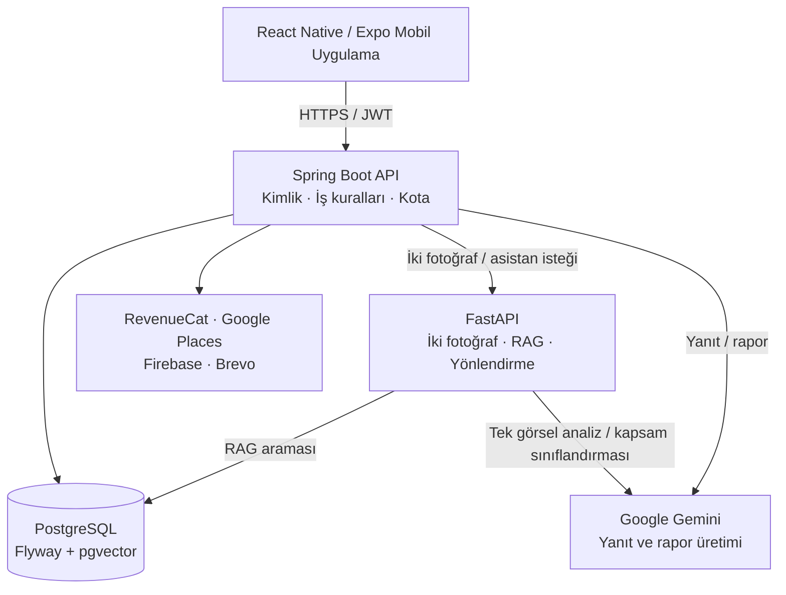
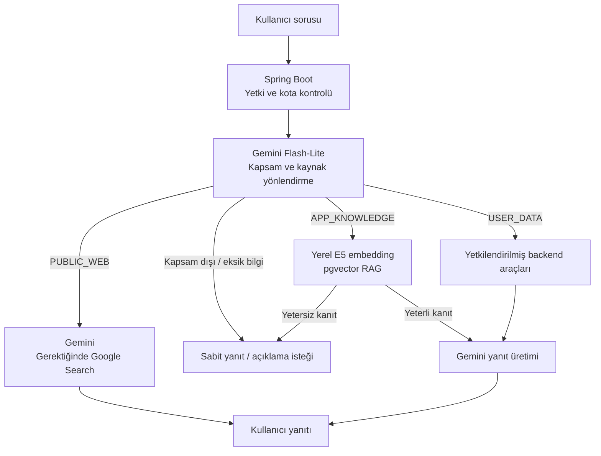

# EksperSiz

**Yapay zekâ destekli araç hasar ön değerlendirmesi, raporlama ve araç yönetimi platformu.**

**Google Play:** [EksperSiz](https://play.google.com/store/apps/details?id=com.gorkem.ekspersiz) · **Mobil kaynak:** [`mobile-rn/`](mobile-rn/README.md)

React Native/Expo mobil uygulaması, Java/Spring Boot API'si ve Python/FastAPI AI servisini birleştirir. Mevcut analizlerden açıklayıcı raporlar üretir ve araç sahiplerine kayıt, bakım, hatırlatma ve otomotiv odaklı AI Asistan özellikleri sunar. Yeni hasar analizinde genel görünüm ve yakın detay fotoğrafları Gemini tarafından birlikte değerlendirilir; görsel yorum fiziksel ekspertiz yerine geçmez.

<p align="center">
  
  
  
  
</p>

Ekran görselleri önceki Flutter sürümünün tarihsel örnekleridir; güncel RN arayüz kanıtları [migration görsel kaydındadır](docs/migration/VISUAL_PARITY.md).

## Özellikler

- **Hasar analizi:** İki ayrı fotoğrafla Gemini görsel değerlendirmesi; görünür hasar türü, etkilenen parçalar, şiddet ve olası onarım. Belirsiz/yetersiz fotoğraflarda ek kanıt istenir.
- **Rapor ve tutanak:** Görsel bulgulardan yerel hasar anlatımı ve Gemini fiyat tahmini; isteğe bağlı Google Search kaynaklarıyla desteklenen onarım maliyet aralıkları, analiz geçmişi ve PDF tutanağı.
- **Araç yönetimi:** Araç profilleri, kilometre/bakım kayıtları, muayene ve bakım hatırlatmaları, birleşik araç geçmişi.
- **AI Asistan:** Araç, bakım ve muayene soruları; uygulama bilgi tabanı; yetkili kullanıcının araç, hasar ve hatırlatma kayıtları; Türkçe sesli giriş.
- **Entegrasyonlar:** Yakındaki servisler (Google Maps/Places), uygulama içi ve FCM bildirimleri, e-posta/Google ile giriş.
- **Çalışma alanları ve krediler:** Tek oturumla kişisel/şirket alanı seçimi; ayrı araçlar, raporlar ve kredi havuzları. Mevcut RevenueCat satın alma/abonelik kuralları ve şirket rolleri korunur.

## Sistem mimarisi



**Mimari kararlar:** React Native/Expo, mobil arayüzü özellik bazlı modüllere ayırır; Spring Boot kimlik doğrulama, veri sahipliği, ödeme ve iş kurallarının otoritesidir. Python/FastAPI, asistan yönlendirmesini ve bilgi erişimini API katmanından ayırır. PostgreSQL + pgvector, uygulama verileri ve vektör araması için ayrı bir vektör veritabanı hizmeti gereksinimini azaltır. Backend ve AI servisi Docker ile Railway üzerinde ayrı dağıtılır.

## AI mimarisi

### İki fotoğrafla hasar değerlendirmesi

Kullanıcı, hasarın bulunduğu araç parçasını gösteren **genel görünüm** ile aynı hasarın **yakın detayını** ekler.
FastAPI, boyut/format/çözünürlük kontrolü ve EXIF temizliğinin ardından iki görseli tek
`gemini-3.8-flash` isteğinde işler. Native JSON Schema çıktısı Python ve Java'da bağımsız doğrulanır.
Hasar derecesi `MINOR / MODERATE / SEVERE / UNKNOWN` olabilir; parça değişimi kesinleştirilmez.
Yeni bulgulara dedektör kutuları veya güven yüzdeleri eklenmez.

Spring Boot, kredi rezervasyonu, yetki, geçmiş, rapor ve fiyat tahmini sorumluluğunu korur.
Görsel analizden sonra mevcut Gemini fiyat araştırması/tahmini kullanılır; rapor anlatımı yerel oluşturulur.
Belirsiz/başarısız analizlerde kredi tamamlanmaz; rapor hatasından sonra tekrar yalnız raporu üretir.
Eski kayıt ve PDF'ler okunmaya devam eder. Yerel görsel model, eğitim veri seti ve inference ağırlığı kalmaz.

Analiz test e-postası kısıtı olmadan, mevcut plan/kredi ve şirket yetkileri kapsamında açıktır.
Hasar Analiz Raporu; şiddet, parça bazında bulgu/onarım ve maliyet aralığını tek ekranda birleştirir.
Uzun anlatım açılabilir ayrıntılarda korunur; PDF paylaşımı ve ayrı Hasar Durum Tutanağı kullanılabilir.
Sunucudaki `DAMAGE_ANALYSIS_ENABLED=false` bakım anahtarı korunur.
[Genel erişim, doğrulama ve Railway yayın sırası](docs/GEMINI_GENERAL_ACCESS_REPORT_UX.md).

[Mimari, yapılandırma, sözleşme, gizlilik ve testler](docs/GEMINI_VISION_ANALYSIS.md).

### Kaynağa göre yönlendirilen AI Asistan



**İşleyiş:** Kapsam dışı veya kanıtı yetersiz sorular ana yanıt modeline gönderilmez. RAG yalnızca EksperSiz uygulama bilgisini içerir; kişisel veriler yetkili backend araçlarıyla alınır. Başarılı yanıtlar günlük kotadan düşülür, başarısız çağrıların rezervasyonu serbest bırakılır.

Ayrıntılar: [AI Asistan mimarisi](docs/ai-assistant/ARCHITECTURE.md).

### Onarım fiyatı tahmini

Fiyat hesaplaması yalnızca Gemini'nin görsel bulguları, önerilen işlem, araç ve şehir bilgilerini kullanır. Backend, varsayılan olarak Google Search grounding ile güncel fiyat örnekleri arar; **yalnızca gerçek web kaynakları dönerse** bu özeti ikinci Gemini çağrısındaki yapılandırılmış fiyat tahminine dahil eder. Doğrulanmış web referansı yoksa veya arama başarısızsa genel piyasa bilgilerine dayalı tahmine döner; güncel fiyat doğrulaması iddia etmez. Parça bazında mükerrer maliyet yazılmaması istenir, farklı fiyat düzeylerini çarpıtabilecek sabit 10.000 TL fiyat aralığı sınırı kullanılmaz. Bunlar yine teklif değil tahmindir.

`PRICE_WEB_SEARCH_ENABLED=false` ile fiyatlar için ekstra Google Search çağrısı kapatılabilir; kapalıyken sistem eskisi gibi tek Gemini çağrısıyla fiyat üretir. Açıkken **başarılı aramada iki Gemini çağrısı ve potansiyel Google Search sorgu ücreti** vardır (özellikle aramalar çok sayıda sorgu çalıştırırsa). Arama maliyetleri, gecikme, kaynak doğruluğu ve yerel servis teklifleriyle sapma izlenmelidir. Asistanın genel web araması bu ayardan bağımsızdır. Üretim için aynı araç/hasar/şehir senaryolarında karşılaştırmalı doğrulama yapılmalıdır.

## Güvenlik ve veri bütünlüğü

- **Kimlik ve yetki:** JWT, Spring Security, BCrypt, Google ID token doğrulaması; kullanıcı ve BUSINESS OWNER/MEMBER kaynak erişim kontrolleri.
- **AI veri izolasyonu:** LLM'e doğrudan veritabanı erişimi verilmez; kullanıcıya özel sorgular sunucu tarafında yetkilendirilir. Kaynak metinleri ve sohbet geçmişi güvenilmeyen girdi kabul edilir.
- **Ödeme ve kota:** RevenueCat doğrulama/senkronizasyonu, mükerrer işlem koruması, plan geçerlilik kontrolü ve eşzamanlı AI soru rezervasyonları.
- **Veri yönetimi:** Flyway şema sürümleme, görsel yükleme doğrulaması, sürümlü bilgi tabanı ingest süreci ve tutanaklar için SHA-256 içerik özeti.

## Maliyet ve ölçeklenebilirlik yaklaşımı

| Karar | Amaç / ödünleşim |
| --- | --- |
| Flash-Lite ile erken kapsam kontrolü | Konu dışı sorularda ana Gemini yanıt çağrısını önler; sınıflandırmanın kendisi de ücretli bir API çağrısıdır. |
| Yerel embedding + pgvector | Harici embedding ve ayrı vektör veritabanı hizmetlerine bağımlılığı azaltır; CPU/RAM ve PostgreSQL kapasitesi izlenmelidir. |
| Kanıt eşiği ve sınırlı RAG bağlamı | Gereksiz üretimi ve prompt boyutunu sınırlar; yetersiz kanıtta yanıt uydurulmaz. |
| Sunucu taraflı kota ve rezervasyon | Kontrolsüz kullanım ve eşzamanlı kota aşımını sınırlar. |
| Ayrı Spring Boot / FastAPI servisleri | İş yükleri bağımsız yönetilebilir; artan trafikte AI çıkarımı için ayrı worker/altyapı gerekebilir. |

**Korunan optimizasyonlar:** E5 embedding ve RAG retriever ihtiyaç anında tek sefer yüklenir; JVM heap sınırlandırması korunur. Ayrıntılar için [optimizasyon kayıtları](docs/cost/OPTIMIZATIONS.md).

## Teknolojiler

| Katman | Teknolojiler |
| --- | --- |
| Mobil | React Native, Expo, TypeScript, Expo Router, Google Sign-In, Firebase Messaging, Google Maps, RevenueCat |
| Backend | Java 21, Spring Boot 4.1, Spring Security, JPA, Flyway |
| AI/ML | Python, FastAPI, Google Gemini Vision, SentenceTransformers / E5, pgvector |
| Veri | PostgreSQL, pgvector |
| Dağıtım ve entegrasyon | Docker, Railway, Google Play, Google Places, Brevo |

## Çalışma alanları ve kullanım hakları

Şirket sahibi ve üyeleri aynı oturumla **Kişisel Hesap** ve **Şirket Hesabı** arasında geçiş yapabilir.
Araçlar, analiz geçmişi, asistan bağlamı, kredi havuzu ve araç kapasitesi aktif alana göre belirlenir.
Şirkete katılmak kişisel araçları veya satın alınmış kredileri şirkete taşımaz.

Kişisel kullanım `user:{id}`, şirket kullanımı `business:{id}` cüzdanından karşılanır;
yetersiz bakiyede diğer havuz kullanılmaz. Şirket üyeleri ortak kredileri kullanabilir,
şirket adına satın alma yetkisi mevcut OWNER kuralına tabidir. Business sahibinin kişisel
alanı ayrı kalır; Business aboneliği kişisel alana şirket kotası vermez.

Mevcut kredi modelinde şirket aboneliği 10 ortak araç kapasitesi ve abonelik dönemi başına
100 analiz / 200 asistan kredisi içerir. Kişisel kalıcı kredi/slotlar, uygun başlangıç
kredileri ve önceki PLUS/PRO dönem hakları mevcut backend kurallarıyla yönetilir.
[Güncel kredi sistemi](docs/billing/CREDIT_SYSTEM.md) ·
[Workspace mimarisi, güvenlik ve yayın sırası](docs/architecture/PERSONAL_BUSINESS_WORKSPACES.md).

Business satın alımı sunucuda doğrulanınca **Şirketini oluştur** adımı açılır.
Şirket adı ve açık onayınızla kurulum tamamlanır; üyelik yenilenip workspace yetkisi
doğrulandıktan sonra şirket alanına geçilir. Yarım kalan kuruluma **Krediler ve
Paketler → Şirketini oluştur** yolundan tekrar ödeme yapmadan devam edebilirsiniz.
Sandbox abonelikleri üretimde Business hakkı vermez.
[Business satın alma ve sorun giderme](docs/billing/BUSINESS_WORKSPACE_ONBOARDING.md).

## Geliştirme ve test

**Gereksinimler:** Java 21, Node (`mobile-rn/.nvmrc`), Android SDK / macOS için Xcode, Python 3.12, PostgreSQL/pgvector ve ilgili servis kimlik bilgileri. Hasar modeli ağırlığı gerekli değildir.

```bash
# Backend
./mvnw test

# Mobil (mobile-rn dizininde)
cd mobile-rn
npm ci
npm run typecheck
npm run lint
npm test -- --ci
npm run test:ci-scripts
npm run check:config
npm run audit:ci
cd ..

# AI servisi (ai-service dizininde)
pip install -r requirements.txt
python -m unittest discover -s tests
```

Yerel çalıştırma için backend ve AI servisinin ortam değişkenleri (`DATABASE_URL`, `DB_USERNAME`, `DB_PASSWORD`, `JWT_SECRET`, `AI_SERVICE_BASE_URL`, `GEMINI_API_KEY` vb.) tanımlanmalıdır. Harita, ödeme, Google girişi, e-posta ve bildirim entegrasyonları ayrıca yapılandırma gerektirir. Bu komutlar **testlerin çalıştırılma yoludur**; bu README güncellemesinde test sonucu iddia edilmez.

## Dokümantasyon ve depo yapısı

- [Mobil uygulama](mobile-rn/README.md) — React Native/Expo geliştirme, native smoke testleri ve servis ayarları
- [Android release](docs/production/ANDROID_RELEASE.md) — mevcut Play kimliği ve upload key ile RN yayın akışı
- [Flutter son temizlik kaydı](docs/migration/FLUTTER_CLEANUP.md) — kaldırılan araçlar, korunan uyumluluk ve kalan tarihsel referanslar
- [AI servis](ai-service/README.md) — Gemini hasar analizi, asistan, embedding/RAG ve test
- [AI Asistan mimarisi](docs/ai-assistant/ARCHITECTURE.md) — yönlendirme, RAG, yetkili araçlar ve kota
- [AI Asistan dağıtımı](docs/ai-assistant/DEPLOYMENT.md) — Docker, bilgi tabanı ingest ve readiness
- [AI Asistan değerlendirme senaryoları](docs/ai-assistant/evaluation-v1.jsonl)
- [Railway günlük hatırlatma cron tasarımı](docs/REMINDER_CRON.md) — uyuyan backend için güvenli tetikleme, dağıtım ve kontrol
- [Railway maliyet ve bellek optimizasyon kayıtları](docs/cost/OPTIMIZATIONS.md) — kararlar, deneyler, geçerli ayarlar ve izlenecek metrikler

`src/` Spring Boot API'sini, `mobile-rn/` etkin React Native/Expo istemcisini, `ai-service/` Gemini ve asistan servisini, `docs/` teknik belgeleri ve ekran görüntülerini içerir. Eski Flutter `mobile/` kaynak ağacı [PR #49](https://github.com/GorkemErtas/ekspersiz/pull/49) ile depodan kaldırılmıştır; tarihsel kaynak ve değişiklikler Git geçmişinde korunur.

Mobil Inter/Roboto fontları, Material Icons ve lisansları `mobile-rn/assets/fonts/` içinde bağımsızdır. FCM geçişinde önceki kurulumun token temizliği ve onboarding işareti uyumluluğu korunur. Java/Python bağımlılıkları `ops/security/audit_dependencies.py --fail-on-findings`, RN lockfile'ı `npm run audit:ci` ile denetlenir; registry/OSV erişim hataları başarılı sonuç sayılmaz.

> **Sorumluluk reddi:** AI hasar tespiti ve üretilen raporlar bilgilendirme amaçlı ön değerlendirmelerdir; profesyonel ekspertiz, mekanik inceleme veya resmî hasar tespitinin yerine geçmez.

---

**Geliştirici:** Görkem Ertaş · Yazılım Mühendisi · Full-Stack & AI/ML

Copyright © 2026 Görkem Ertaş. All rights reserved.
