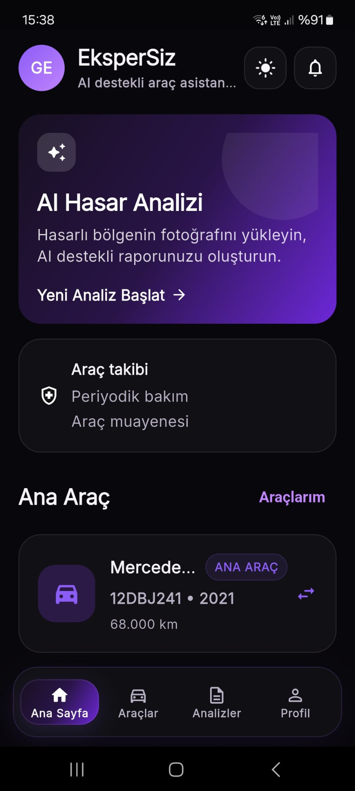
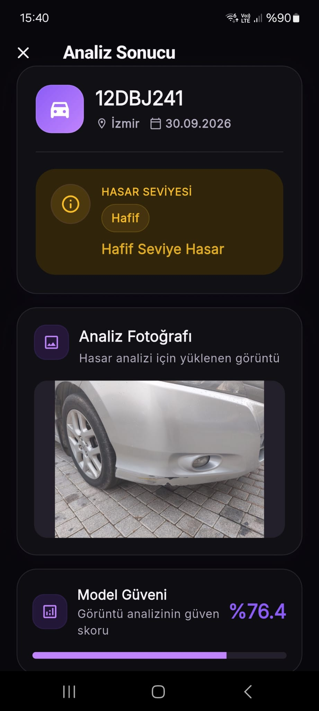
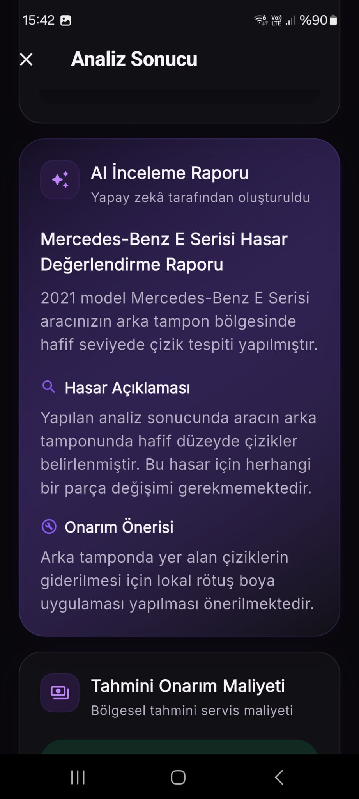
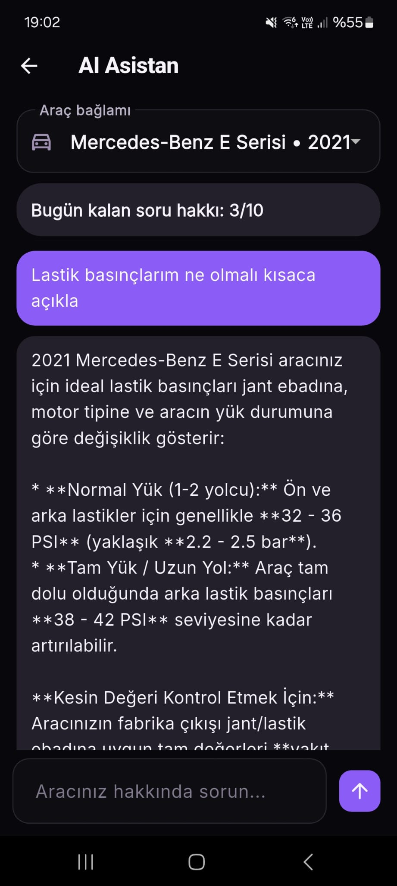
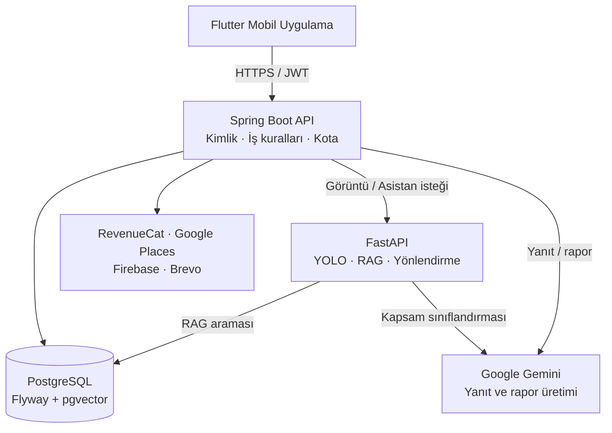
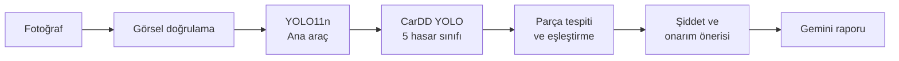
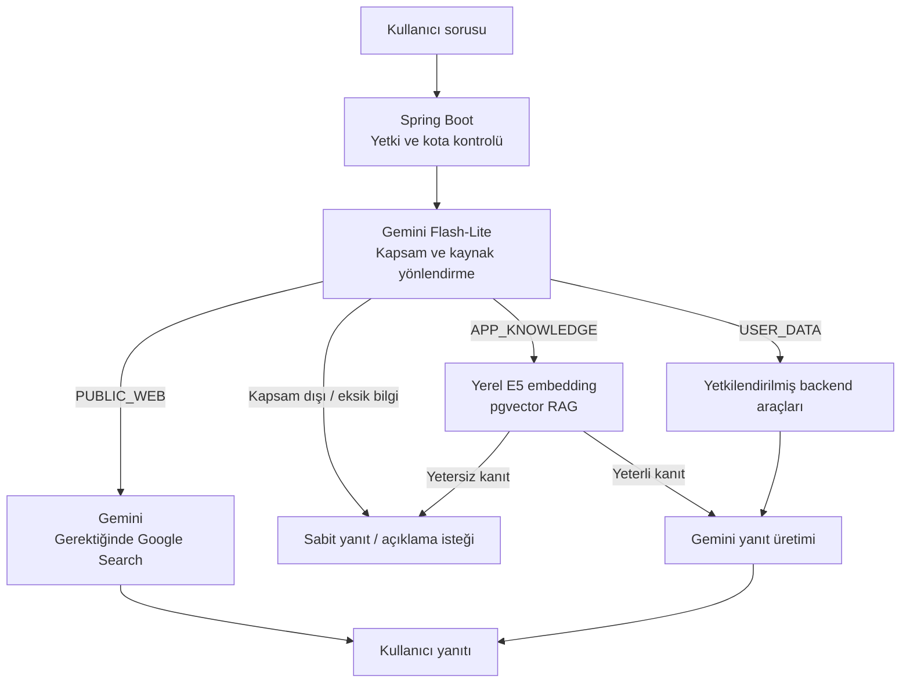

# EksperSiz

**Yapay zekâ destekli araç hasar ön değerlendirmesi, raporlama ve araç yönetimi platformu.**

Flutter mobil uygulaması, Java/Spring Boot API'si ve Python/FastAPI AI servisini birleştirir. Araç fotoğraflarından görünür hasarları tespit eder, açıklayıcı raporlar üretir ve araç sahiplerine kayıt, bakım, hatırlatma ve otomotiv odaklı AI Asistan özellikleri sunar.

<p align="center">
  
  
  
  
</p>

## Özellikler

- **AI hasar analizi:** Fotoğraf kalite kontrolü, araç/hasar/parça tespiti, hasar-parça eşleştirmesi, şiddet sınıflandırması ve onarım önerileri.
- **Rapor ve tutanak:** Gemini destekli hasar ön değerlendirmesi, tahmini onarım maliyet aralıkları, analiz geçmişi ve PDF olarak paylaşılabilen hasar değerlendirme tutanağı.
- **Araç yönetimi:** Araç profilleri, kilometre/bakım kayıtları, muayene ve bakım hatırlatmaları, birleşik araç geçmişi.
- **AI Asistan:** Araç, bakım ve muayene soruları; uygulama bilgi tabanı; yetkili kullanıcının araç, hasar ve hatırlatma kayıtları; Türkçe sesli giriş.
- **Entegrasyonlar:** Yakındaki servisler (Google Maps/Places), uygulama içi ve FCM bildirimleri, e-posta/Google ile giriş.
- **Planlar:** FREE, PLUS, PRO ve BUSINESS; RevenueCat abonelikleri, FREE planın aylık hasar ve günlük asistan hakları, şirket üyeleri ve paylaşımlı kotalar.

## Sistem mimarisi



**Mimari kararlar:** Flutter, mobil arayüzü özellik bazlı modüllere ayırır; Spring Boot kimlik doğrulama, veri sahipliği, ödeme ve iş kurallarının otoritesidir. Python/FastAPI, ML çıkarımını ve bilgi erişimini API katmanından ayırır. PostgreSQL + pgvector, uygulama verileri ve vektör araması için ayrı bir vektör veritabanı hizmeti gereksinimini azaltır. Backend ve AI servisi Docker ile Railway üzerinde ayrı dağıtılır.

## AI/ML tasarımı

### Görüntüden hasar ön değerlendirmesi



Aktif hasar sınıfları: `SCRATCH`, `DENT`, `CRACK`, `BROKEN_PART`, `BROKEN_GLASS`. `NO_VISIBLE_DAMAGE` eğitilmiş bir sınıf değil, kurallı sonuç durumudur. Rapor yeniden oluşturulurken kaydedilmiş başarılı ML analizi tekrar kullanılabilir. Model eğitim, CarDD veri aktarımı ve değerlendirme ayrıntıları [AI servis dokümantasyonunda](ai-service/README.md) bulunur.

### Kaynağa göre yönlendirilen AI Asistan



**İşleyiş:** Kapsam dışı veya kanıtı yetersiz sorular ana yanıt modeline gönderilmez. RAG yalnızca EksperSiz uygulama bilgisini içerir; kişisel veriler yetkili backend araçlarıyla alınır. Başarılı yanıtlar günlük kotadan düşülür, başarısız çağrıların rezervasyonu serbest bırakılır.

Ayrıntılar: [AI Asistan mimarisi](docs/ai-assistant/ARCHITECTURE.md).

## Güvenlik ve veri bütünlüğü

- **Kimlik ve yetki:** JWT, Spring Security, BCrypt, Google ID token doğrulaması; kullanıcı ve BUSINESS OWNER/MEMBER kaynak erişim kontrolleri.
- **AI veri izolasyonu:** LLM'e doğrudan veritabanı erişimi verilmez; kullanıcıya özel sorgular sunucu tarafında yetkilendirilir. Kaynak metinleri ve sohbet geçmişi güvenilmeyen girdi kabul edilir.
- **Ödeme ve kota:** RevenueCat doğrulama/senkronizasyonu, mükerrer işlem koruması, plan geçerlilik kontrolü ve eşzamanlı AI soru rezervasyonları.
- **Veri yönetimi:** Flyway şema sürümleme, görsel yükleme doğrulaması, sürümlü bilgi tabanı ingest süreci ve tutanaklar için SHA-256 içerik özeti.

## Maliyet ve ölçeklenebilirlik yaklaşımı

| Karar | Amaç / ödünleşim |
| --- | --- |
| Flash-Lite ile erken kapsam kontrolü | Konu dışı sorularda ana Gemini yanıt çağrısını önler; sınıflandırmanın kendisi de ücretli bir API çağrısıdır. |
| Yerel embedding + pgvector | Harici embedding ve ayrı vektör veritabanı hizmetlerine bağımlılığı azaltır; CPU/RAM ve PostgreSQL kapasitesi izlenmelidir. |
| Kanıt eşiği ve sınırlı RAG bağlamı | Gereksiz üretimi ve prompt boyutunu sınırlar; yetersiz kanıtta yanıt uydurulmaz. |
| Yerel YOLO çıkarımı ve analiz tekrar kullanımı | Görüntü başına harici görsel AI API ücreti yerine sunucu işlem kaynağı kullanır; yüksek trafikte çıkarım kapasitesi darboğaz olabilir. |
| Sunucu taraflı kota ve rezervasyon | Kontrolsüz kullanım ve eşzamanlı kota aşımını sınırlar. |
| Ayrı Spring Boot / FastAPI servisleri | İş yükleri bağımsız yönetilebilir; artan trafikte AI çıkarımı için ayrı worker/altyapı gerekebilir. |

**Uygulanan optimizasyonlar (Ekim 2026):** YOLO ve embedding modellerinin ihtiyaç anında tek sefer yüklenmesi, eşzamanlı görüntü çıkarımının sınırlandırılması, dosya okuma ve gereksiz görüntü kopyalarının azaltılması, JVM heap sınırlandırması. Ölçülmüş fayda sağlamayan Hikari havuzu daraltması ve varsayılanı kapalı Linux heap temizleme kodu geri alındı; fotoğraf netliği hesaplamasında önceki hassasiyet korundu. Ayrıntılar için [optimizasyon kayıtları](docs/cost/OPTIMIZATIONS.md). Doğrulanmış aylık tasarruf oranı iddia edilmez.

## Teknolojiler

| Katman | Teknolojiler |
| --- | --- |
| Mobil | Flutter, Dart, Google Sign-In, Firebase Messaging, Google Maps, RevenueCat |
| Backend | Java 21, Spring Boot 4.1, Spring Security, JPA, Flyway |
| AI/ML | Python, FastAPI, Ultralytics YOLO, Google Gemini, SentenceTransformers |
| Veri | PostgreSQL, pgvector |
| Dağıtım ve entegrasyon | Docker, Railway, Google Play, Google Places, Brevo |

## Planlar

| Plan | Araç | Aylık analiz | AI Asistan |
| --- | ---: | ---: | --- |
| FREE | 1 | 1 | 3 başarılı yanıt/gün |
| PLUS | 3 | 5 | 3 başarılı yanıt/gün |
| PRO | 10 | 10 | 5 başarılı yanıt/gün |
| BUSINESS | 50 (şirket) | 100 (şirket) | 10 başarılı yanıt/gün (ortak) |

FREE planda **ayda 1 detaylı hasar analizi** ve **günde 3 AI Asistan başarılı yanıtı** bulunur; Plus denemesi sunulmaz. Abonelik iptali, ödenmiş dönemin kalan haklarını hemen sona erdirmez. Hasar analizi ve AI Asistan kullanım kotaları ayrı yönetilir.

## Geliştirme ve test

**Gereksinimler:** Java 21, Flutter/Dart SDK, Python 3.12, PostgreSQL/pgvector ve ilgili servis kimlik bilgileri. Üretim YOLO ağırlıkları Git'te tutulmaz; AI servisinde belirtilen konumlara sağlanmalıdır.

```bash
# Backend
./mvnw test

# Mobil
cd mobile && flutter pub get && flutter test

# AI servisi (ai-service dizininde)
pip install -r requirements.txt
pytest
```

Yerel çalıştırma için backend ve AI servisinin ortam değişkenleri (`DATABASE_URL`, `DB_USERNAME`, `DB_PASSWORD`, `JWT_SECRET`, `AI_SERVICE_BASE_URL`, `GEMINI_API_KEY` vb.) tanımlanmalıdır. Harita, ödeme, Google girişi, e-posta ve bildirim entegrasyonları ayrıca yapılandırma gerektirir. Bu komutlar **testlerin çalıştırılma yoludur**; bu README güncellemesinde test sonucu iddia edilmez.

## Dokümantasyon ve depo yapısı

- [Mobil uygulama](mobile/README.md) — Flutter özellikleri ve geliştirme
- [AI servis ve model değerlendirme](ai-service/README.md) — YOLO, CarDD, eğitim ve test
- [AI Asistan mimarisi](docs/ai-assistant/ARCHITECTURE.md) — yönlendirme, RAG, yetkili araçlar ve kota
- [AI Asistan dağıtımı](docs/ai-assistant/DEPLOYMENT.md) — Docker, bilgi tabanı ingest ve readiness
- [AI Asistan değerlendirme senaryoları](docs/ai-assistant/evaluation-v1.jsonl)
- [Railway maliyet ve bellek optimizasyon kayıtları](docs/cost/OPTIMIZATIONS.md) — kararlar, deneyler, geçerli ayarlar ve izlenecek metrikler

`src/` Spring Boot API'sini, `mobile/` Flutter istemcisini, `ai-service/` AI/ML servisini, `docs/` teknik belgeleri ve ekran görüntülerini içerir.

> **Sorumluluk reddi:** AI hasar tespiti ve üretilen raporlar bilgilendirme amaçlı ön değerlendirmelerdir; profesyonel ekspertiz, mekanik inceleme veya resmî hasar tespitinin yerine geçmez.

---

**Geliştirici:** Görkem Ertaş · Yazılım Mühendisi · Full-Stack & AI/ML
