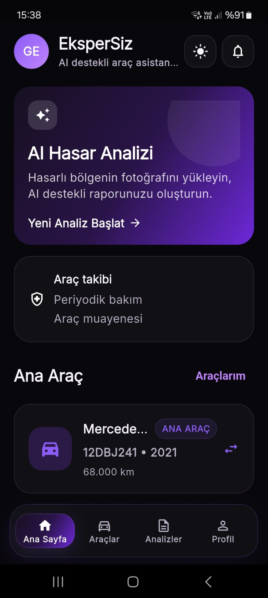
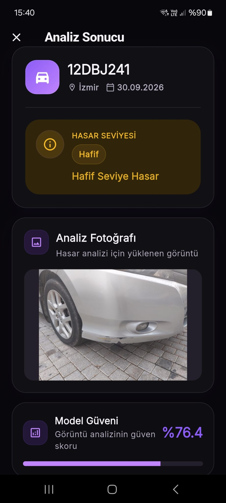
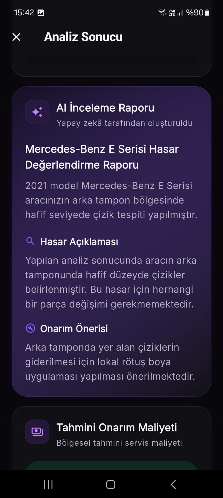
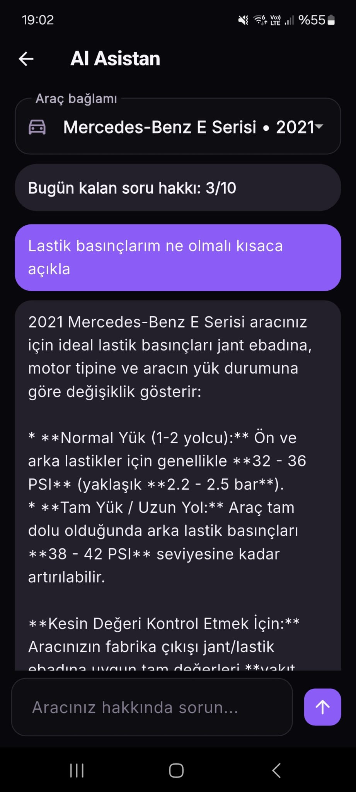
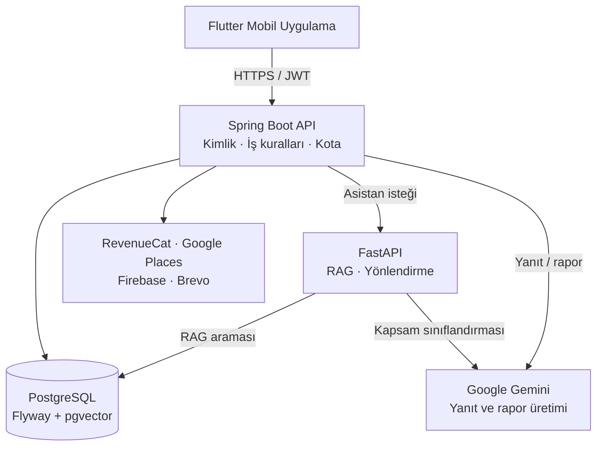
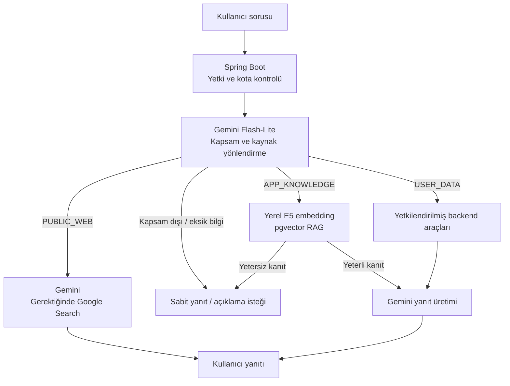

# EksperSiz

**Yapay zekâ destekli araç hasar ön değerlendirmesi, raporlama ve araç yönetimi platformu.**

Flutter mobil uygulaması, Java/Spring Boot API'si ve Python/FastAPI AI servisini birleştirir. Mevcut analizlerden açıklayıcı raporlar üretir ve araç sahiplerine kayıt, bakım, hatırlatma ve otomotiv odaklı AI Asistan özellikleri sunar. Hasar modelleri üretim kabul ölçütlerini geçene kadar yeni fotoğraf analizi kapalıdır.

<p align="center">
  
  
  
  
</p>

## Özellikler

- **Hasar analizi:** Yeni analiz ve modele bağlı fotoğraf doğrulama geçici olarak kapalıdır; mevcut analiz geçmişi ve raporlar korunur.
- **Rapor ve tutanak:** ML sonuçlarından yerel hasar anlatımı ve Gemini fiyat tahmini; isteğe bağlı Google Search kaynaklarıyla desteklenen onarım maliyet aralıkları, analiz geçmişi ve PDF tutanağı.
- **Araç yönetimi:** Araç profilleri, kilometre/bakım kayıtları, muayene ve bakım hatırlatmaları, birleşik araç geçmişi.
- **AI Asistan:** Araç, bakım ve muayene soruları; uygulama bilgi tabanı; yetkili kullanıcının araç, hasar ve hatırlatma kayıtları; Türkçe sesli giriş.
- **Entegrasyonlar:** Yakındaki servisler (Google Maps/Places), uygulama içi ve FCM bildirimleri, e-posta/Google ile giriş.
- **Planlar:** FREE, PLUS, PRO ve BUSINESS; RevenueCat abonelikleri, FREE planın aylık hasar ve günlük asistan hakları, şirket üyeleri ve paylaşımlı kotalar.

## Sistem mimarisi



**Mimari kararlar:** Flutter, mobil arayüzü özellik bazlı modüllere ayırır; Spring Boot kimlik doğrulama, veri sahipliği, ödeme ve iş kurallarının otoritesidir. Python/FastAPI, asistan yönlendirmesini ve bilgi erişimini API katmanından ayırır. PostgreSQL + pgvector, uygulama verileri ve vektör araması için ayrı bir vektör veritabanı hizmeti gereksinimini azaltır. Backend ve AI servisi Docker ile Railway üzerinde ayrı dağıtılır.

## AI/ML tasarımı

### Hasar analizi deneyleri

HITL veri setinin gerçek 8 hasar ve 21 parça sınıfı, Python/Java/Flutter arasında sürümlü katalogla korunur. İlk YOLOX-Tiny baseline, kısmi etiketli görüntülerde yalnızca etiketli görevi eğiten ortak omurga ve iki head kullanır. Lisansı ayrı doğrulanan RF-DETR ve RT-DETR COCO ağırlıklarıyla transfer öğrenme adayları da aynı analiz sözleşmesini kullanır; hasar ve mevcut parça grafikleri ONNX Runtime üzerinde ayrı çalışabilir.

50 epoch sıfırdan eğitim tamamlanmıştır; tarihsel test ayrımında hasar başarısı üretim için yetersizdir. Bu nedenle analiz/doğrulama **varsayılan kapalıdır**, HTTP 503 döner ve kredi ayrılmaz. Model bundle onayı ve açık release ayarları olmadan etkinleşmez. [Veri, mimari ve komutlar](docs/ml/UNIFIED_YOLOX_TINY.md), [gerçek sonuçlar](docs/ml/HITL_RESULTS.json).

Yeni [transfer öğrenme yöntemi ve tekrar çalıştırma adımları](docs/ml/TRANSFER_LEARNING.md), [lisans/kaynak incelemesi](docs/ml/COMMERCIAL_LICENSE_REVIEW.md) ve [karşılaştırma sonuçları](docs/ml/TRANSFER_RESULTS.md) ayrı kaydedilir. SYNDCAR, iki ortak sınıf için eğitimden ayrı bir sentetik alan farkı kontrolüdür. Deploy veya otomatik üretim onayı yapılmaz.

**Görsel hasar şiddeti:** CC0 HITL hasar bölgelerinden yalnızca bağımsız uzman kontrolüyle oluşturulan `MINOR/MODERATE/SEVERE` etiketleri için lisansı doğrulanmış hafif bir MobileNetV3 eğitim/ONNX entegrasyon yolu hazırlandı. Şu an şiddet modeli **eğitilmedi ve onaylanmadı**; `UNKNOWN` korunur. Kaynak denetimi, etiketleme şeması, eğitim ve güvenlik koşulları: [görsel şiddet deney planı](docs/ml/VISUAL_SEVERITY.md).

### Kaynağa göre yönlendirilen AI Asistan



**İşleyiş:** Kapsam dışı veya kanıtı yetersiz sorular ana yanıt modeline gönderilmez. RAG yalnızca EksperSiz uygulama bilgisini içerir; kişisel veriler yetkili backend araçlarıyla alınır. Başarılı yanıtlar günlük kotadan düşülür, başarısız çağrıların rezervasyonu serbest bırakılır.

Ayrıntılar: [AI Asistan mimarisi](docs/ai-assistant/ARCHITECTURE.md).

### Onarım fiyatı tahmini

Fiyat hesaplaması yalnızca ML'in tespit ettiği hasar, önerilen işlem, araç ve şehir bilgilerini kullanır. Backend, varsayılan olarak Google Search grounding ile güncel fiyat örnekleri arar; **yalnızca gerçek web kaynakları dönerse** bu özeti ikinci Gemini çağrısındaki yapılandırılmış fiyat tahminine dahil eder. Doğrulanmış web referansı yoksa veya arama başarısızsa genel piyasa bilgilerine dayalı tahmine döner; güncel fiyat doğrulaması iddia etmez. Parça bazında mükerrer maliyet yazılmaması istenir, farklı fiyat düzeylerini çarpıtabilecek sabit 10.000 TL fiyat aralığı sınırı kullanılmaz. Bunlar yine teklif değil tahmindir.

`PRICE_WEB_SEARCH_ENABLED=false` ile fiyatlar için ekstra Google Search çağrısı kapatılabilir; kapalıyken sistem eskisi gibi tek Gemini çağrısıyla fiyat üretir. Açıkken **başarılı aramada iki Gemini çağrısı ve potansiyel Google Search sorgu ücreti** vardır (özellikle aramalar çok sayıda sorgu çalıştırırsa). Arama maliyetleri, gecikme, kaynak doğruluğu ve yerel servis teklifleriyle sapma izlenmelidir. Asistanın genel web araması bu ayardan bağımsızdır. Üretim için aynı araç/hasar/şehir senaryolarında karşılaştırmalı doğrulama yapılmalıdır.

## Güvenlik ve veri bütünlüğü

- **Kimlik ve yetki:** JWT, Spring Security, BCrypt, Google ID token doğrulaması; kullanıcı ve BUSINESS OWNER/MEMBER kaynak erişim kontrolleri.
- **AI veri izolasyonu:** LLM'e doğrudan veritabanı erişimi verilmez; kullanıcıya özel sorgular sunucu tarafında yetkilendirilir. Kaynak metinleri ve sohbet geçmişi güvenilmeyen girdi kabul edilir.
- **Ödeme ve kota:** RevenueCat doğrulama/senkronizasyonu, mükerrer işlem koruması, plan geçerlilik kontrolü ve eşzamanlı AI soru rezervasyonları.
- **Veri yönetimi:** Flyway şema sürümleme, görsel yükleme doğrulaması, sürümlü bilgi tabanı ingest süreci ve tutanaklar için SHA-256 içerik özeti.

## Maliyet ve ölçeklenebilirlik yaklaşımı

| Karar | Amaç / ödünleşim |
| --- | --- |
| Flash-Lite ile erken kapsam kontrolü | Konu dışı sorularda ana Gemini yanıt çağrısını önler; sınıflandırmanın kendisi de ücretli bir API çağrısıdır. |
| Yerel embedding + pgvector | Harici embedding ve ayrı vektör veritabanı hizmetlerine bağımlılığı azaltır; CPU/RAM ve PostgreSQL kapasitesi izlenmelidir. |
| Kanıt eşiği ve sınırlı RAG bağlamı | Gereksiz üretimi ve prompt boyutunu sınırlar; yetersiz kanıtta yanıt uydurulmaz. |
| Sunucu taraflı kota ve rezervasyon | Kontrolsüz kullanım ve eşzamanlı kota aşımını sınırlar. |
| Ayrı Spring Boot / FastAPI servisleri | İş yükleri bağımsız yönetilebilir; artan trafikte AI çıkarımı için ayrı worker/altyapı gerekebilir. |

**Korunan optimizasyonlar:** E5 embedding ve RAG retriever ihtiyaç anında tek sefer yüklenir; JVM heap sınırlandırması korunur. Ayrıntılar için [optimizasyon kayıtları](docs/cost/OPTIMIZATIONS.md).

## Teknolojiler

| Katman | Teknolojiler |
| --- | --- |
| Mobil | Flutter, Dart, Google Sign-In, Firebase Messaging, Google Maps, RevenueCat |
| Backend | Java 21, Spring Boot 4.1, Spring Security, JPA, Flyway |
| AI/ML | Python, FastAPI, YOLOX-Tiny eğitim, ONNX Runtime, Google Gemini, SentenceTransformers |
| Veri | PostgreSQL, pgvector |
| Dağıtım ve entegrasyon | Docker, Railway, Google Play, Google Places, Brevo |

## Planlar

| Plan | Araç | Aylık analiz | AI Asistan |
| --- | ---: | ---: | --- |
| FREE | 1 | 1 | 3 başarılı yanıt/ay |
| PLUS | 3 | 5 | 3 başarılı yanıt/gün |
| PRO | 10 | 10 | 5 başarılı yanıt/gün |
| BUSINESS | 50 (şirket) | 100 (şirket) | 10 başarılı yanıt/gün (ortak) |

FREE planda **ayda 1 detaylı hasar analizi** ve **ayda 3 AI Asistan başarılı yanıtı** bulunur; Plus denemesi sunulmaz. Abonelik iptali, ödenmiş dönemin kalan haklarını hemen sona erdirmez. Hasar analizi ve AI Asistan kullanım kotaları ayrı yönetilir.

## Geliştirme ve test

**Gereksinimler:** Java 21, Flutter/Dart SDK, Python 3.12, PostgreSQL/pgvector ve ilgili servis kimlik bilgileri. Hasar modeli ağırlığı gerekli değildir.

```bash
# Backend
./mvnw test

# Mobil
cd mobile && flutter pub get && flutter test

# AI servisi (ai-service dizininde)
pip install -r requirements.txt
python -m unittest discover -s tests
```

Yerel çalıştırma için backend ve AI servisinin ortam değişkenleri (`DATABASE_URL`, `DB_USERNAME`, `DB_PASSWORD`, `JWT_SECRET`, `AI_SERVICE_BASE_URL`, `GEMINI_API_KEY` vb.) tanımlanmalıdır. Harita, ödeme, Google girişi, e-posta ve bildirim entegrasyonları ayrıca yapılandırma gerektirir. Bu komutlar **testlerin çalıştırılma yoludur**; bu README güncellemesinde test sonucu iddia edilmez.

## Dokümantasyon ve depo yapısı

- [Mobil uygulama](mobile/README.md) — Flutter özellikleri ve geliştirme
- [AI servis](ai-service/README.md) — Asistan, RAG, geçici analiz durumu ve test
- [AI Asistan mimarisi](docs/ai-assistant/ARCHITECTURE.md) — yönlendirme, RAG, yetkili araçlar ve kota
- [AI Asistan dağıtımı](docs/ai-assistant/DEPLOYMENT.md) — Docker, bilgi tabanı ingest ve readiness
- [AI Asistan değerlendirme senaryoları](docs/ai-assistant/evaluation-v1.jsonl)
- [Railway günlük hatırlatma cron tasarımı](docs/REMINDER_CRON.md) — uyuyan backend için güvenli tetikleme, dağıtım ve kontrol
- [Railway maliyet ve bellek optimizasyon kayıtları](docs/cost/OPTIMIZATIONS.md) — kararlar, deneyler, geçerli ayarlar ve izlenecek metrikler

`src/` Spring Boot API'sini, `mobile/` Flutter istemcisini, `ai-service/` AI/ML servisini, `docs/` teknik belgeleri ve ekran görüntülerini içerir.

> **Sorumluluk reddi:** AI hasar tespiti ve üretilen raporlar bilgilendirme amaçlı ön değerlendirmelerdir; profesyonel ekspertiz, mekanik inceleme veya resmî hasar tespitinin yerine geçmez.

---

**Geliştirici:** Görkem Ertaş · Yazılım Mühendisi · Full-Stack & AI/ML
