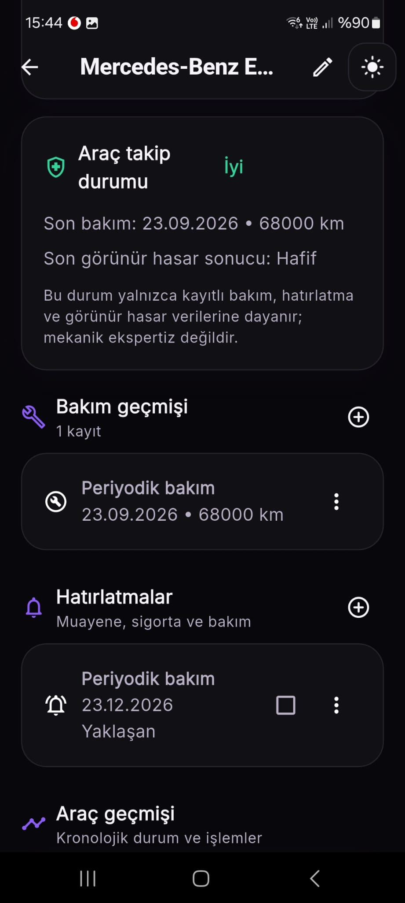

# 🚗 EksperSiz

**Yapay zekâ destekli araç hasar analizi, raporlama ve araç yönetimi uygulaması.** Flutter istemcisi, Spring Boot REST API'si ve FastAPI tabanlı bilgisayarlı görü/RAG servisinden oluşur.

> **Yayın:** Google Play'de test kanalları (açık/kapalı test). Android sürümü: `1.0.0+31` (depodaki Flutter yapılandırması). Test kanalındaki inceleme/yayın durumu Google Play Console'dan doğrulanmalıdır.

## 📱 Ekran görüntüleri

<p align="center">
  
  
  
  
</p>

## ✨ Özellikler

- **Hasar analizi:** Fotoğraf uygunluk kontrolü; ana aracın, görünür hasarın ve etkilenen parçanın YOLO ile tespiti; hasar-parça eşleştirmesi, hasar seviyesi ve onarım önerileri.
- **Analiz raporu:** Gemini ile yapılandırılmış ekspertiz ön değerlendirmesi, konuma göre tahmini onarım maliyet aralıkları; analiz/rapor geçmişi; başarılı ML analizini tekrarlamadan raporu yeniden üretme.
- **Görsel yükleme:** JPG/PNG/WEBP, en fazla 10 MB; hasar görseline ek bağlam fotoğrafı ve ön/arka bölge bilgisi desteği.
- **AI Asistan:** Otomotiv ve uygulama odaklı sohbet; anlamsal konu/niyet sınıflandırması; kaynaklı RAG yanıtları; eksik bilgiler için açıklama isteme; yetkili kullanıcıya ait araç, hasar ve hatırlatma verilerine kontrollü erişim.
- **Araç yönetimi:** Marka/model kataloğu, araç ekleme/düzenleme, ana araç seçimi, kilometre, bakım kayıtları, muayene ve tarih/kilometre bazlı hatırlatmalar, araç durumu ve birleşik geçmiş.
- **Hasar değerlendirme tutanağı:** Tamamlanan analizden taslak oluşturma; olay, konum ve beyan bilgilerini düzenleme; kesinleştirilmiş salt-okunur veri anlık görüntüsü, SHA-256 içerik özeti ve PDF paylaşımı.
- **Yakındaki servisler:** Konum ve Google Maps/Places ile çevredeki otomotiv servislerini görüntüleme.
- **Bildirimler:** Uygulama içi bildirim merkezi, planlı hatırlatmalar ve yapılandırılabilir Firebase Cloud Messaging.
- **Hesap:** E-posta/şifre ve Google ile giriş, e-posta doğrulama, şifre sıfırlama/değiştirme, hesap silme, güvenli oturum saklama.
- **Arayüz:** Türkçe/İngilizce, açık/koyu tema, zorunlu Android sürüm güncelleme kontrolü.
- **Kurumsal kullanım:** OWNER/MEMBER rolleri, üye daveti/yönetimi, ortak şirket araçları, analiz geçmişi ve şirket kotası.

## 💳 Planlar ve haklar

| Plan | Aktif araç | Aylık hasar analizi | AI Asistan |
| --- | ---: | ---: | --- |
| **FREE** | 1 | 1 | Kapalı |
| **PLUS** | 3 | 5 | Günde 3 başarılı yanıt |
| **PRO** | 10 | 10 | Günde 5 başarılı yanıt |
| **BUSINESS** | Şirket genelinde 50 | Şirket genelinde 100 | Ekip genelinde günde 10 başarılı yanıt |

- **7 günlük PLUS denemesi:** FREE hesaplarda profilden bir kez, ödeme yöntemi olmadan başlatılır; otomatik ücretli aboneliğe dönüşmez. Süre dolunca etkin plan yeniden FREE olur.
- **Ücretli abonelikler:** PLUS/PRO/BUSINESS aylık ürünleri; Google Play satın alma akışı RevenueCat üzerinden, yetkiler ve webhook/senkronizasyon backend üzerinden yönetilir.
- **İptal/sona erme:** Abonelik hakları, ödenmiş dönemin bitişine kadar etkin kalabilir; plan hesabı sunucuda geçerlilik süresine göre yapılır.
- **Asistan kotası:** Başarılı yanıtlar sayılır; kapsam dışı, açıklama isteyen veya başarısız istekler günlük yanıt hakkını tüketmez. Eşzamanlı istekler için süreli kota rezervasyonu kullanılır; kapsam dışı tekrarlarında geçici erişim kilidi uygulanır.
- **Analiz kredileri:** Kod tabanında tek seferlik `analysis_1`, `analysis_3`, `analysis_10` kredi paketleri, işlem geçmişi, mükerrer işlem önleme ve iade yönetimi de bulunur. Bu mekanizma aylık plan limitlerinden ayrı ele alınır.

## 🏗 Mimari ve veri akışı

```text
Flutter (Android; iOS proje altyapısı)
    │ HTTPS / JWT
    ▼
Spring Boot 4.1 / Java 21 REST API
    ├── PostgreSQL + Flyway (uygulama, kullanıcı, kota, fatura, rapor)
    ├── FastAPI / Python
    │     ├── YOLO görüntü analizi
    │     └── Anlamsal yönlendirme + RAG / pgvector
    ├── Google Gemini (raporlar ve asistan yanıtları)
    ├── Google Maps / Places (yakındaki servisler)
    ├── RevenueCat / Google Play (abonelikler)
    ├── Firebase / FCM (anlık bildirimler)
    └── Brevo (işlemsel e-posta)
```

- **Mobil:** `mobile/lib/core` (ağ, JWT oturumu, tema, yerelleştirme, bildirim, güncelleme); `mobile/lib/features` (auth, home, inspection, ai_assistant, vehicle, billing, business, notification, profile).
- **Backend:** `src/main/java/.../controller` → `service` → `repository`/`entity`; DTO tabanlı API; Spring Security, JWT, JPA/Hibernate, Flyway, plan/üyelik/yetki kontrolleri.
- **AI servisi:** `ai-service/main.py` HTTP giriş noktası; `app/damage_analyzer.py` görüntü işleme; `app/assistant` sınıflandırma, ayrıştırma, embedding, retrieval ve kanıt doğrulama.
- **Veritabanı:** PostgreSQL; şema geçişleri `src/main/resources/db/migration/V1...V12`; RAG bilgi tabanı için pgvector, 384 boyutlu çok dilli embedding ve kosinüs benzerliği.
- **Dağıtım:** Backend ve AI servisi ayrı Docker konteynerleriyle Railway üzerinde; yapılandırma ortam değişkenleriyle. Yüklenen görüntüler backend dosya depolama katmanında yönetilir.

## 🧠 Hasar analizi nasıl çalışır?

1. Görselin biçimi, boyutu ve uygunluğu kontrol edilir.
2. `yolo11n.pt` ile ana araç belirlenir/kırpılır.
3. `damage_detection_v2_cardd_5class.pt` ile **SCRATCH, DENT, CRACK, BROKEN_PART, BROKEN_GLASS** hasarları aranır.
4. `vehicle_part_best.pt` ile araç parçaları belirlenir; kutu örtüşmesine göre hasar-parça eşleştirilir.
5. Kurallı hasar şiddeti ve onarım önerisi üretilir; görünür hasar yoksa `NO_VISIBLE_DAMAGE` sonuç olarak döner (eğitilmiş sınıf değildir).
6. Spring Boot, ML sonucunu saklar; Gemini ile açıklama, öneri ve tahmini maliyet içeren rapor oluşturur. Rapor hatasında mevcut analiz yeniden kullanılabilir.

**Model geliştirme:** CarDD veri kümesi aktarımı, beş sınıflı etiket eşlemesi, eğitim, bağımsız test kümesi değerlendirmesi ve hata analizi betikleri `ai-service/scripts` altındadır. Ayrıntı: [AI servis dokümanı](ai-service/README.md).

## 💬 AI Asistan nasıl çalışır?

1. Flutter, soruyu Spring Boot'a gönderir; kimlik, plan, kilit ve günlük kota doğrulanır.
2. FastAPI anlamsal kapsam/niyet sınıflandırması yapar; gerekirse ek bilgi ister.
3. Genel bilgi için küratörlü kaynaklardan **RAG** (parçalama → yerel embedding → PostgreSQL/pgvector → ilgili kaynakları seçme) kullanılır.
4. Kullanıcıya özel veri gerekiyorsa yalnızca backend'in yetkilendirdiği araç/hasar/hatırlatma sorguları çalışır; özel kullanıcı verileri vektör bilgi tabanına gömülmez.
5. Gemini, sağlanan kanıt/araç bağlamından yanıt üretir; yeterli kanıt yoksa tahminde bulunmama yaklaşımı uygulanır.
6. Başarılı yanıt kotaya işlenir; başarısız işlem rezervasyonu serbest bırakılır.

- **Bilgi tabanı:** `ai-service/knowledge`, kaynak manifesti ve `scripts/ingest_assistant_knowledge.py`.
- **Tasarım/kurulum:** [AI Asistan mimarisi](docs/ai-assistant/ARCHITECTURE.md) · [Dağıtım](docs/ai-assistant/DEPLOYMENT.md).

## 🔐 Güvenlik ve dayanıklılık

- JWT oturumu, BCrypt parola özeti, sunucuda Google ID token doğrulaması, güvenli mobil token depolama.
- Kullanıcı/şirket rolü ve kaynak sahipliği kontrolleri; asistanın doğrudan veritabanı erişimi yoktur.
- Yükleme MIME/imza ve boyut doğrulaması, dosya yolu güvenliği; API anahtarları ortam değişkenlerinde.
- RevenueCat sunucu doğrulaması, webhook/işlem tekrarına karşı koruma, kota ve eşzamanlı kullanım rezervasyonları.
- Flyway şema sürümleme; Docker dağıtımı, servis sağlık uç noktaları ve AI servisinin geçici erişilemezliğine karşı istemci akışı.
- AI sonuçları **bilgilendirme amaçlıdır**; profesyonel ekspertiz, servis incelemesi veya resmî hasar tespitinin yerine geçmez.

## 🛠 Teknolojiler

| Katman | Teknolojiler |
| --- | --- |
| Mobil | Flutter, Dart, Google Sign-In, Maps, Firebase Messaging, RevenueCat, PDF/share |
| API | Java 21, Spring Boot 4.1, Spring Security, JWT, JPA, Flyway, Maven |
| ML | Python, FastAPI, Ultralytics YOLO, NumPy, Pillow |
| Üretken AI | Google Gemini, RAG, çok dilli yerel embedding |
| Veri | PostgreSQL, pgvector |
| Entegrasyon | Google Places, Firebase, RevenueCat, Brevo |
| Altyapı | Docker, Railway, Google Play |

## 📁 Depo yapısı

```text
ekspersiz/
├── src/main/java/              # Spring Boot controller/service/repository/entity/DTO
├── src/main/resources/         # Ayarlar ve Flyway migration'ları
├── src/test/                   # Backend testleri
├── mobile/lib/                 # Flutter uygulaması (core + features)
├── mobile/test/                # Flutter testleri
├── ai-service/app/             # FastAPI, YOLO ve RAG
├── ai-service/knowledge/       # Asistan bilgi kaynakları
├── ai-service/scripts/         # Model eğitim/değerlendirme ve ingest
├── ai-service/tests/           # AI testleri
├── docs/                       # Ekran görüntüleri ve mimari dokümanları
├── Dockerfile                  # Backend imajı
├── docker-entrypoint.sh
└── pom.xml
```

## 🧪 Test ve yerel çalıştırma

- **Backend:** `./mvnw test` (Windows: `mvnw.cmd test`).
- **Flutter:** `cd mobile && flutter pub get && flutter test`; Android geliştirme için `flutter run`.
- **AI servisi:** `cd ai-service && pip install -r requirements.txt && pytest`; servis `uvicorn main:app --reload` ile başlatılabilir.
- **Gereksinimler:** Java 21, Flutter/Dart SDK, Python ve PostgreSQL; servisler için ilgili ortam değişkenleri (örn. `DATABASE_URL`, `DB_USERNAME`, `DB_PASSWORD`, `JWT_SECRET`, `AI_SERVICE_BASE_URL`, `GEMINI_API_KEY`). Harita, giriş, ödeme, e-posta ve FCM entegrasyonları ayrıca kimlik bilgisi gerektirir.
- **Model dosyaları:** Üretimde kullanılan YOLO ağırlıklarının AI servisinde doğru yollarda bulunması gerekir; dağıtım öncesi kontrol edilmelidir.

## 👨‍💻 Geliştirici

**Görkem Ertaş** — Yazılım Mühendisi · Full-Stack & AI/ML
