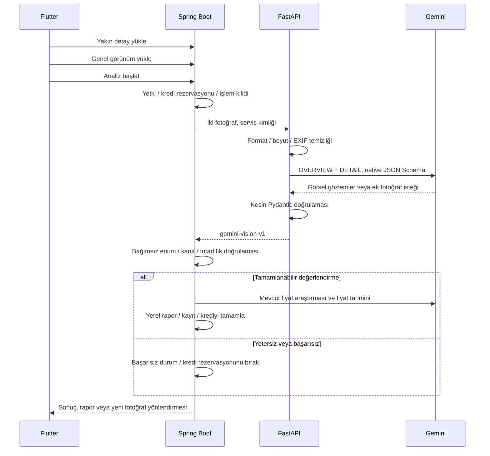

# İki fotoğraflı Gemini görsel değerlendirmesi

Kullanıcı iki **farklı** fotoğraf ekler: hasarın çevresini/parçayı gösteren genel görünüm ve
aynı hasarın yakın detayı. Gemini, ikisini tek bağlam ve tek görsel değerlendirme çağrısında
yorumlar. Bu görsel ön değerlendirmedir; fiziksel ekspertiz veya sürüş güvenliği onayı değildir.

## Katmanlar ve sözleşme

`POST /api/v1/analyze`: multipart `image` yakın detay, `context_image` genel görünüm;
`vehicle_region` yalnız isteğe bağlı FRONT/REAR ipucudur. Tek fotoğraflı yeni analiz yoktur.
Java'nın eski `requireContext=false` parametresi iki fotoğraf koşulunu devre dışı bırakamaz.
Fotoğraf uygunluğu uçları yalnız teknik yerel kontrol yapar; ayrı görsel LLM çağrısı oluşturmaz.

`gemini-vision-v1` çıktısı `DAMAGE_DETECTED`, `NEEDS_MORE_PHOTOS` veya `INCONCLUSIVE` içerir.
Şiddet `MINOR / MODERATE / SEVERE / UNKNOWN` olabilir. Her bulgu tür, parça, görsel açıklama,
olası onarım, değişim belirsizliği ve fotoğraf kanıt rollerini içerir. Bir bulgunun şiddeti
belirsizse genel şiddet de UNKNOWN kalır. Yetersiz/uyuşmayan fotoğraflar başarılı hasar
sonucuna dönüştürülemez. Kanıt yokluğu hasarsızlık kanıtı değildir.

`confidenceScore=null`, `detections=[]`, `partDetections=[]`: Gemini'ye dedektör güven yüzdesi
veya kutu koordinatı uydurtulmaz. `partReplacementRequired=null` korunur; olası işlem ile
kesin değişim gereksinimi ayrıdır. `visualFindings`, mevcut `analysis_payload` JSON sütununa
yazılır. Eski enumlar, tablolar, görüntüler, raporlar ve tamamlanmış tutanak snapshot'ları
değiştirilmez. Tarihsel dedektör verileri okunabilir; yeni yazım yalnız yeni sözleşmedir.

## Model, ticari kullanım ve veri işleme

Varsayılan `gemini-3.8-flash`, inceleme tarihinde Google'ın stable Flash modelidir;
[model listesi](https://ai.google.dev/gemini-api/docs/models) ve
[görsel anlama](https://ai.google.dev/gemini-api/docs/image-understanding) belgeleri esas alındı.
Seçim kalite/gecikme/maliyet dengesi içindir; bu projede gerçek fotoğraflarla ölçülmüş
doğruluk iddiası değildir. Model adı `GEMINI_VISION_MODEL` ile değiştirilebilir.
[Native yapılandırılmış çıktı](https://ai.google.dev/api/generate-content#v1beta.GenerationConfig)
ve ayrıca iki katmanda doğrulama kullanılır.

Yerel görsel ağırlık/framework dağıtılmaz. Gemini bir ticari API hizmetidir;
[Google API ek koşulları](https://ai.google.dev/gemini-api/terms) uygulanır.
Kişisel/veri içerebilen fotoğraflar için aktif faturalandırmalı proje kullanılmalıdır:
ücretsiz hizmetin verileri ürün geliştirmede kullanılabilir; ücretli hizmet için farklı
veri işleme koşulları vardır. Ücretli API de kötüye kullanım denetimi amacıyla sınırlı
saklama yapabilir; sıfır sağlayıcı saklaması iddia edilmez. Bu çalışma hesap/billing
durumunu doğrulamaz ve canlı sağlayıcıya veri göndermez.

Python yalnız bu iki fotoğrafı iletir; kullanıcı kimliği, araç plakası, dosya adı,
konum koordinatı veya geçmiş kayıtları görsel isteğe eklenmez. EXIF/GPS temizlenir,
fotoğraflar en fazla 2048 piksele ölçeklenip JPEG'e çevrilir; Cloud Files/caching
kullanılmaz. Kullanıcıya kadraja insan/plaka almaması söylenir. Görselin içinde kalan
kişisel bilgilerin otomatik maskelendiği iddia edilmez. Backend'in mevcut yetkili görüntü
saklama, hesap silme ve eski kayıt temizleme kuralları sürer; Python ek kopya saklamaz.

## Sınırlar, maliyet ve yapılandırma

- Her fotoğraf en fazla 10 MiB / 24 MP; kısa kenar en az 256 piksel. Gerçek dosya formatı,
  MIME, decode, hareketli dosya ve aynı görüntü kontrolleri uygulanır. Görsel yeterlilik,
  netlik ve iki fotoğraf ilişkisi tek Gemini aşamasında değerlendirilir.
- Servis kimliği multipart okumadan önce doğrulanır. İstek gövdesi 22 MiB ile sınırlıdır;
  chunked aktarım da sınıra tabidir. Görsel decode/analiz kapasitesi aynı anda bir istektir.
- Varsayılan toplam sağlayıcı süre bütçesi 35 saniye, çıktı sınırı 4096 token,
  Gemini 3.8 için desteklenmeyen `temperature` ve `candidateCount` alanları gönderilmez;
  API'nin varsayılan tek aday davranışı kullanılır. Aynı sonuç/aynı maliyet garantisi değildir.
- Yalnız açık HTTP 429 reddi en fazla bir kez, aynı toplam süre bütçesinde denenir.
  Timeout/5xx, geçersiz JSON, bloke veya kesilmiş yanıt yeni ücretli çağrıyla onarılmaz.
- Log: model, süre, deneme, giriş/çıkış/düşünme tokenları ve yaklaşık USD maliyeti.
  Fotoğraf, ham LLM yanıtı, API anahtarı veya kişisel tanımlayıcı loglanmaz.
- [Fiyat](https://ai.google.dev/gemini-api/docs/pricing) için 2026-10-25 snapshot'ı:
  milyon giriş tokenı 0.75 USD, çıkış/düşünme 3.75 USD. Bunlar konfigürasyondur;
  model/fiyat değişince güncellenmelidir. Gerçek fatura, vergi, fiyat araştırması ve
  uygulama kredileri bu yaklaşık görsel çağrı maliyetinden farklıdır.

[Sunucu örnek ortamı](../ai-service/.env.example). API anahtarı mobil uygulamaya verilmez.
`DAMAGE_ANALYSIS_ENABLED=false` bakım kapısıdır; varsayılan açık olsa da sunucu anahtarı
olmadan hazır görünmez ve ücretli çalışma başlatılmaz. Java ve Python aynı servis sırrını
kullanır. Fotoğraf hizmetinin anahtarı Asistan'ın kendi routing/yanıt ayarlarını değiştirmez.

## Kredi, geçmiş ve rapor

Kredi rezervasyonu mevcut cüzdan/şirket paylaşım kurallarıyla yapılır; yalnız başarılı
analiz **ve rapor** sonunda tamamlanır. Ek fotoğraf, timeout, geçersiz yanıt ve rapor
hatasında rezervasyon bırakılır. İşlem kimliği, rezervasyon ve rapor denemesi korumaları
korunur. Kayıp HTTP yanıtından sonra Flutter önce işlemi sorgular; başarılı analizi yeniden
çalıştırmaz. Rapor başarısızsa yalnız fiyat/rapor aşaması tekrar edilir.

Başlamış incelemenin fotoğrafları değiştirilemez. Ek fotoğraf isteyen başarısız kayıt
ücretsiz olarak geçmişte kalır; düzeltilecek fotoğraf çifti yeni bir incelemeye yüklenir.
Eski `NONE` sonuçları ve raporları okunur; yeni belirsiz sonuç `NONE` yapılmaz.
Görsel açıklama ve olası onarım rapor/PDF anlatımında korunur. Mevcut fiyat araması ve
tahmini araç, şehir, şiddet ve onarım bağlamını kullanmaya devam eder.

## Kaldırılanlar ve korunanlar

Görsel model runtime'ı, eğitim/değerlendirme araçları, veri setleri, ağırlıklar, manifestler,
özel eğitim ortamları ve eski model dokümanları kaldırıldı. Yerel ML paketleri servis
bağımlılığı olmaktan çıkarıldı. AI Asistan'ın E5/SentenceTransformers/PyTorch, semantic
routing, pgvector, RAG, ingestion ve yetkili backend araçları korunur. Asistan kullanım
belgesi yeni akışa göre güncellendi; çalışan veritabanına ingestion yapılmadı.

Mock testleri sözleşme ve hata davranışını doğrular. Canlı Gemini doğruluğu, sağlayıcı
kotası, gerçek fatura, gerçek Railway gecikmesi ve üretim kabulü bu testlerin sonucu değildir.
Deploy, Railway başlatma veya production release yapılmaz.

[Yerel test sonuçları ve doğrulama sınırları](GEMINI_VISION_VALIDATION.md).

## Genel erişim

Test e-postası kısıtı kaldırıldı. `DAMAGE_ANALYSIS_TEST_ONLY` ve
`DAMAGE_ANALYSIS_TEST_EMAILS` artık okunmaz; Railway backend değişkenlerinden
kaldırılmalıdır. Bu, mevcut kredi/abonelik/şirket yetkilerinden bağımsız bir hak vermez.

`DAMAGE_ANALYSIS_ENABLED` Spring backend ve Python AI servisinde açık olmalıdır.
Kapalı bakım anahtarı ve başarısız readiness yeni görsel analiz/doğrulamayı kredi
ayırmadan durdurur. Geçmişi okuma ve mevcut bulgulardan yalnız rapor üretme davranışı korunur.
Flutter aynı isimli derleme seçeneğinde varsayılan `true` kullanır; sunucu kapısını aşamaz.

Hasar Analiz Raporu ve PDF aynı sunum kurallarını kullanır. Bulgu ve onarım notları
parça bazında birleştirilir; tahmin üstte, tekrar eden anlatım açılabilir ayrıntılardadır.
Eski rapor metinleri, belirsizlikler, uyarılar ve kaynak bilgisi korunur.
Yeni Gemini çağrısı, şema değişikliği veya geçmiş kayıt güncellemesi yoktur.

[Yayın sırası, değişkenler ve bu çalışmanın test sonuçları](GEMINI_GENERAL_ACCESS_REPORT_UX.md).
