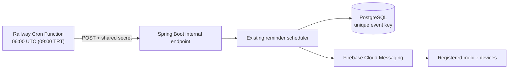

# Daily reminder delivery on Railway

## Why the existing schedule was unreliable

`ReminderNotificationScheduler` is a Spring `@Scheduled` task at 09:00
`Europe/Istanbul`. Firebase Cloud Messaging (FCM) only delivers messages
**after** the backend evaluates due reminders. Railway Serverless (App Sleeping)
stops the JVM, so it cannot run its in-process task while sleeping. Waking up
later does not replay that missed execution.

Production uses a **Railway Cron Function** to invoke the existing evaluation
via a dedicated authenticated API endpoint. The regular backend and Postgres
can remain in sleep mode; the AI server configuration is unchanged.

## Production configuration

| Service | Variable / setting | Value |
| --- | --- | --- |
| Backend | `REMINDER_JOB_TOKEN` | Same long, randomly generated secret as the worker; never commit it |
| Backend | `NOTIFICATION_SCHEDULE_CRON` | `-` (disables in-JVM Spring scheduling when external cron owns delivery) |
| Backend | `FCM_ENABLED` | `true` for actual device push delivery |
| Backend | `FIREBASE_CREDENTIALS_JSON` | Valid Firebase Admin credentials, configured privately |
| Railway Cron Function | `REMINDER_JOB_TOKEN` | Same value as backend |
| Railway Cron Function | `REMINDER_BACKEND_URL` | `https://ekspersiz-backend-production.up.railway.app` |
| Railway Cron Function | `cronSchedule` | `0 6 * * *` (Railway schedules in UTC) |
| Railway Cron Function | `restartPolicyType` | `NEVER` (only cron starts it) |

The worker is the exact script at `ops/railway/reminder-cron.ts`. The Railway
Function source is separately configured; keep the two versions in sync.

**Deploy order:** (1) merge and deploy the backend endpoint; (2) configure both
identical secrets and disable the backend's Spring scheduler in the same Railway
change as enabling the cron worker; (3) run one controlled test, inspect the
worker logs and check that a test user's app notification is created. Do not
commit the Railway patch before the new backend has successfully deployed.

## Failure and duplicate handling

- Railway may cold-start the backend and Postgres. The worker retries transient
  errors/502/timeouts up to eight attempts, waiting 15 seconds between them.
- An invalid shared secret returns HTTP 401 and **does not** run the task.
  A missing backend-side token returns HTTP 503; the worker eventually fails.
- The backend delegates to the **existing** notification logic. Previously
  created event keys are checked in the database and are also protected by the
  `(user_id, event_key)` unique constraint. Disabling the in-process scheduler
  in production avoids competing simultaneous triggers.
- Railway cron runs are **not guaranteed to fire at the exact minute**.
  Their target is 09:00 Türkiye time. Failed executions need inspection in the
  Railway cron execution history; no automatic next-day recovery is guaranteed.
- FCM is a separate integration: successfully running the scheduler does not
  prove that a phone received its push. Check `FCM_ENABLED`, credentials,
  device tokens, app permissions, and Firebase delivery results.
- This change **does not** alter due-date rules, subscription/billing flows,
  AI service, database schema, or mobile client.

## Verification checklist

1. Verify that the Railway cron service shows `cronSchedule: 0 6 * * *` and
   its previous execution completed successfully.
2. Verify that the backend `NOTIFICATION_SCHEDULE_CRON=-`, and that both
   services hold the same `REMINDER_JOB_TOKEN` without exposing the value.
3. On a test vehicle with a reminder due today or within an existing threshold,
   trigger **once** using the Railway cron execution feature or the protected
   endpoint and inspect the in-app notification and FCM device result.
4. Repeat the execution; for already-created event keys, no second app
   notification should be created.
5. Watch the next scheduled execution and investigate failures; use UTC timestamps
   carefully (`06:00 UTC = 09:00 TRT`).

## Rollback

Disable the new cron worker, then restore
`NOTIFICATION_SCHEDULE_CRON=0 0 9 * * *` **only if keeping the backend awake**.
Re-enabling the Spring schedule while allowing the JVM to sleep restores the
original reliability issue. Removing the new internal endpoint is safe after
the worker is disabled; no schema rollback is involved.
