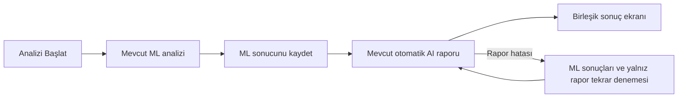

# Kullanıcı açısından tek aşamalı hasar analizi

Taban: `master` / `6b66bb5`. Dal: `feat/unified-damage-analysis`.

## İnceleme sonucu

Kredi cüzdanı kullanan mevcut backend, `/analyze` içinde ML'den sonra raporu
zaten otomatik üretiyordu. Bu akış ve Gemini rapor/fiyat servisi korunuyor.
Eksik olanlar mobilde aşamaların takibi, bağlantı kopmasında kayıtlı sonucun
kurtarılması ve otomatik raporun işlem/deneme durumunun doğru işaretlenmesiydi.

## Akış

1. Tek fotoğraf ve ön/arka seçilir; **Analizi Başlat** basılır. Mevcut upload ve
   kalite kontrolü korunur. Yeni endpoint veya ikinci fotoğraf yoktur.
2. Tek `AnalyzingScreen`, ML hasar tespitini ve ardından AI raporu/maliyet
   hazırlığını gösterir. Aşama, mevcut `GET /inspections/{id}` verisinden okunur;
   zaman tahminiyle tamamlanmış gibi gösterilmez.
3. Başarılı `/analyze` yanıtı raporu içeriyorsa ek `/report` çağrılmaz. Mevcut
   otomatik raporu olmayan eski sunucu `COMPLETED + PENDING` döndürürse, yalnız
   bu tamamlanmış POST yanıtından sonra mevcut `/report` bir kez otomatik çağrılır.
4. Sonuç ekranı ML bulguları, şiddet, parçalar, öneriler, AI raporu ve mevcut
   maliyet kartını birlikte gösterir. Normal akışta **Detaylı AI Raporu Oluştur**
   düğmesi yoktur. Hasarsız sonuçta mevcut yerel rapor ve sıfır maliyet davranışı
   korunur; Gemini çağrılmaz.

## Hata ve tekrar deneme davranışı

- Analiz POST'u sürerken iki saniyede bir mevcut durum okunur. GET işlemleri
  çakışmaz; ek ML veya Gemini işi başlatmaz. Tam sonuç okunabilirse kaybolan POST
  yanıtı beklenmeden gösterilir. Geç gelen yanıt ikinci ekran açmaz.
- Timeout/bağlantı hatasında önce inceleme okunur. Devam eden işlem izlenir;
  başarılı ML yeniden çalıştırılmaz. Sonuç okunamıyorsa **Sonucu Kontrol Et**
  sunulur. Gerçek ML hatasında kullanıcı açıkça tekrar deneyebilir; önce mevcut
  durum okunur ve aynı fotoğraf/bölge korunur.
- İlerleme ekranında üç dakikalık bekleme sınırı vardır. ML kaydedildiyse
  kısmi sonuç korunur; rapor hâlâ sürüyorsa sonuç ekranı izlemeye devam eder.
  Henüz ML sonucu yoksa işlem körlemesine yeniden başlatılmaz.
- Rapor başarısızsa ML kartları kalır; **AI Raporunu Tekrar Dene** yalnız mevcut
  `/report` endpoint'ini kullanır. Önce GET ile tamamlanmış/devam eden rapor
  kontrol edilir; çift tıklama kilidi korunur. Kaybolan retry yanıtı da GET ile
  kurtarılır.
- Sonuç ekranındaki rapor takibi de üç dakika ile sınırlıdır. Uzun süre takılı
  raporda kullanıcı açıkça yalnız raporu tekrar deneyebilir; backend'in mevcut
  işlem kilidi, rezervasyon ve on dakikalık stale iş kontrolü uygulanır. Aktif
  işi atlayan veya otomatik ücretli üretim döngüsü oluşturan bir yol eklenmedi.
- Ekran kapanınca takip timer'ları iptal edilir. Sunucuda başlamış iş iptal
  edilmiş sayılmaz; inceleme/geçmiş kayıtları mevcut kimlikle erişilebilir kalır.

## Backend değişikliğinin sınırları

ML sonucu commit edilirken otomatik rapor `PROCESSING` ve mevcut `report_attempt`
/ `report_started_at` alanlarıyla işaretlenir. Aynı deneme kimliği raporun
başarılı/başarısız kaydında doğrulanır; geç gelen eski üretim yeni denemeyi ezemez.
Rapor bağlamı hazırlanırken oluşan hata da rapor hatasıdır; tamamlanmış ML'yi
`FAILED` yapmaz. Kredi rezervasyonu süresi dolmuş olsa bile aynı rapor denemesi
`FAILED` olabilir; `PROCESSING` durumunda takılı bırakılmaz.

Mevcut politika korunur: rapor başarıyla kaydedilince kredi tamamlanır; rapor
hatasında rezervasyon bırakılır. Yalnız rapor retry'si bir kez ücretlenir.
Tamamlanmış rezervasyon tekrarında kayıtlı sonuç döner, yeni rapor üretilmez.
Eski mobil istemcilerin endpoint'leri ve parametreleri değişmedi.

ML modelleri, parça/şiddet hesapları, rapor içeriği, Gemini fiyat/web araştırması,
auth, DTO'lar, DB şeması, kredi/kota servisleri, fotoğraf önbelleği, geçmiş ve PDF
tutanak mantığı değiştirilmedi. Yeni bağımlılık veya ayrı iş/endpoint mimarisi yok.

## Doğrulama

- `flutter analyze --no-pub`: 0 sorun.
- `flutter test --no-pub --reporter expanded`: 173 test geçti.
- `mvnw.cmd -q test`: 253 test, 0 hata/başarısızlık; mevcut koşullu 23
  veritabanı/entegrasyon testi atlandı (230 başarılı).
- Yeni Flutter testleri: iki temada 320 px/%200 yazıda gerçek aşamalar ve birleşik
  sonuç, rapor hatası, çift tıklama, kaybolan analiz/rapor yanıtı, eski sunucu,
  uzun süreli bekleme, geçmişten takip ve ekran kapatma.
- Backend testleri: otomatik rapor işlem durumu, eşzamanlı retry reddi, stale
  deneme koruması, rapor hazırlama hatasında ML'nin korunması, tamamlanmış ücretli
  analizin tekrarı ve rezervasyon süresi dolduktan sonra yalnız rapor kurtarma.

Bu doğrulama deterministik test/mocked sağlayıcılar kullanır. Gerçek telefon,
üretim veritabanı veya ücretli Gemini ile uçtan uca çalışma yapılmadı; ML/Gemini
çıktı kalitesi ve maliyet tahmini algoritması bu değişikliğin konusu değildir.
