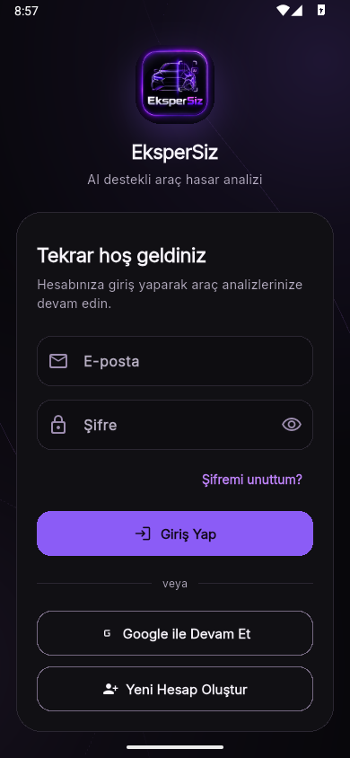
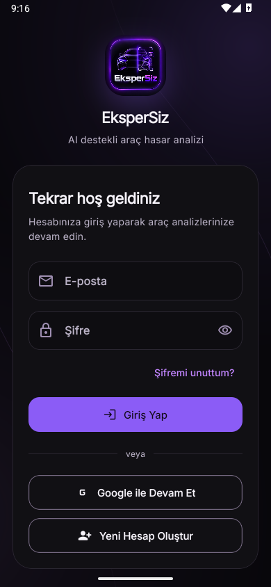
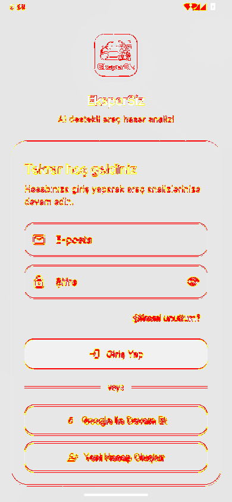

# Flutter visual reference and review gate

The current `mobile/lib/` source is the reference implementation. A screen is not visually accepted until a reviewer has compared a React Native development build with an equivalent Flutter capture. Existing `docs/screenshots/` images can provide historical context; the older UI previews use Roboto and must not be treated as an Inter typography baseline.

## Inspected foundation

| Property                         | Flutter reference                                                                         | RN location / status                                                                                                                                                                                           |
| -------------------------------- | ----------------------------------------------------------------------------------------- | -------------------------------------------------------------------------------------------------------------------------------------------------------------------------------------------------------------- |
| Dark canvas / surface / input    | `#08070B` / `#111014` / `#0E0D11`                                                         | `src/design/tokens.ts`                                                                                                                                                                                         |
| Light canvas / surface / input   | `#F8F6FB` / `#FFFFFF` / `#FCFAFD`                                                         | Tokens                                                                                                                                                                                                         |
| Brand primary / deep / secondary | `#8B5CF6` / `#6D28D9` / `#C084FC`                                                         | Tokens; light primary uses deep violet                                                                                                                                                                         |
| Main / muted text                | dark `#F7F4FB` / `#B9B1C5`; light `#211A29` / `#655C6F`                                   | Tokens                                                                                                                                                                                                         |
| Spacing                          | 4, 8, 15, 22, 30, 36; page inset 18                                                       | Tokens, logical px                                                                                                                                                                                             |
| Corners                          | 12, 16, 24, 28; pill 999                                                                  | Tokens                                                                                                                                                                                                         |
| Minimum touch / button           | 48 / 50, content may grow with text                                                       | Shared components; no text scaling cap                                                                                                                                                                         |
| Typography                       | Inter; headline 22, title 20, body 14/21, input 16/24                                     | Byte-identical original Regular/Medium assets; preserve GoogleFonts family selection and synthetic weight changes; no network font fetching                                                                    |
| Icons                            | Flutter MaterialIcons rounded/outlined codepoints                                         | Same OTF asset and codepoints, Apache license included                                                                                                                                                         |
| Brand gradient                   | `#6D28D9` → `#8B5CF6` → `#C084FC`, top-left to bottom-right                               | Centralized tokens                                                                                                                                                                                             |
| Soft / elevated / brand shadows  | Dual dark shadows, theme-specific light shadows                                           | Centralized RN `boxShadow`; native rendering review pending                                                                                                                                                    |
| Studio surface                   | Two radial lights, stops 0/.42/1, peripheral cubic paths, luminance-dependent opacity     | `StudioBackground.tsx`, direct painter translation; SVG overlay ignores touches and accessibility                                                                                                              |
| Responsive background            | span ≤600, depth ≤1000, viewport anchored                                                 | SVG behind Router; keyboard position must be checked on device                                                                                                                                                 |
| Motion                           | 140/240/320 ms; theme 420; easeOutCubic; press .985; route delta (.025,.018)              | Reanimated press/auth effects and 420ms theme transition; reduced-motion support. Native stack transitions retain platform navigation behavior; frame pacing and exact route-motion matching remain unverified |
| Adaptive columns                 | width ≥760 and text scale ≤1.3                                                            | Home columns implemented; main/tablet captures compared. Large-text and landscape matrix still open                                                                                                            |
| Navigation                       | four cached tabs; surface bar 72, margin 12/10, radius 24; rail ≥900 with text scale ≤1.4 | MainShell implemented, source-derived rail panel/brand/selection positions; nested stack back and tab-to-home Android back handling                                                                            |

## Screens inspected before implementation

Read `app_theme.dart`, `app_background.dart`, `app_motion.dart`, `auth_shell.dart`, `primary_button.dart`, and each corresponding Flutter screen before changing RN presentation.

| Screen                  | Source measurements and behavior                                                                                                                                                                                                                                                                                                                           | RN route                                        | Visual status                                                                                     |
| ----------------------- | ---------------------------------------------------------------------------------------------------------------------------------------------------------------------------------------------------------------------------------------------------------------------------------------------------------------------------------------------------------- | ----------------------------------------------- | ------------------------------------------------------------------------------------------------- |
| Login                   | Max content 460; viewport inset 18/26; 88px logo radius28; title gap16, description gap6, brand-to-card26; card padding22 (17 below360), radius28; card top spacer10, heading22/900; subtitle gap8, fields gap26; 56px inputs separated15; forgot action right aligned; filled primary with dark foreground; divider gap22; outlined Google/register gap12 | `/login`                                        | Widget references and native dark comparison captured; **acceptance failed**, see below           |
| Register                | Same shell, max520; name/email/password/confirm; field gaps15; password guidance surface, 14px padding; CTA `Hesap Oluştur`; divider18; outlined `Zaten Hesabım Var`                                                                                                                                                                                       | `/register`                                     | Flutter references captured; RN native comparison pending                                         |
| Forgot password         | Max460; 54px gradient icon radius18 plus14px title gap; body gap22; code-request state becomes six-digit/new-password/confirm state; submit22; return15; email can be changed without losing route                                                                                                                                                         | `/forgot-password`                              | Both states implemented; initial-state references captured; reset-state capture pending           |
| Email verification      | Max520; 54px gradient icon; 30px heading gap, 26px field gap; 6-digit centered field, 22px/800, letter spacing8; autofocus; 5-minute guidance; verify and resend mutually exclusive                                                                                                                                                                        | `/verify-email?email=...`                       | Flutter references captured; RN native comparison pending                                         |
| Password change         | AppBar60, max640, page inset18/top15/bottom110; AppCard18/radius24; current/new/confirm fields; guidance14; button22                                                                                                                                                                                                                                       | `/change-password`                              | Functional initial port; capture, icon/panel and navigation matching pending                      |
| Profile / MainShell     | Actual Flutter header, source avatar66/radius24, credits/Business/account sections, four cached tabs and wide rail                                                                                                                                                                                                                                         | `/main`; `/account` redirects to the main shell | Native phone profile and dark/light/tablet home comparisons captured; remaining states unverified |
| Vehicles / history      | Source card spacing, primary/tracking chips, toolbar search, overflow menu/FAB and analysis summaries                                                                                                                                                                                                                                                      | MainShell tabs; `/vehicle/...`                  | Dark phone comparisons captured; detail/forms functionally exercised, full visual matrix open     |
| Analysis result / guide | Source summary/findings/cost/actions order, original six-step guide artwork, dark/light assets                                                                                                                                                                                                                                                             | `/inspection/[id]`, `/guide`                    | Dark phone result and first guide page compared; all guide steps and report states not signed off |

## Capture matrix

`mobile-rn/visual/flutter_reference_test.dart` captures the four public auth screens in each combination below (40 captures total). It renders actual Flutter widgets with Inter fonts supplied offline; no Flutter application source or theme is replaced. These are widget captures, without OS chrome or keyboard pixels.

| Name      | Logical viewport | Text scale | DPR | Themes     |
| --------- | ---------------- | ---------- | --- | ---------- |
| compact   | 320 × 640        | 2.0        | 1   | dark/light |
| phone     | 390 × 844        | 1.0        | 1   | dark/light |
| large     | 430 × 932        | 1.5        | 1   | dark/light |
| landscape | 844 × 390        | 1.5        | 1   | dark/light |
| tablet    | 1024 × 768       | 1.0        | 1   | dark/light |

Phone references are saved in `reference/`; all 40 are reproducible under ignored `mobile-rn/visual-artifacts/flutter/`. For a scrolled form, capture the same scroll offset and the same focused field. Add matching keyboard-open, error, loading, disabled, success, empty and offline captures as each corresponding state is ported. These are outstanding gates, not implied by the initial-state captures.

## Native comparison procedure

1. Run a development build with a test backend. Open the same screen, theme and fixture data in Flutter and RN. For public auth screens, no backend is needed to inspect initial layout.
2. Prefer native-to-native captures on the same emulator/device for system chrome, safe area and font rendering. Record OS, resolution, density, font scale, keyboard and reduced-motion settings in an artifact manifest. Flutter widget captures have zero safe-area insets; compare them only with native captures configured identically, or capture equivalent Flutter native screenshots first.
3. Use `adb shell wm size` / `wm density` to inspect configuration. If overriding them, record and restore the original values afterward. A 390×844 image at DPR1 is not equivalent to a 1080×2340 image scaled afterward.
4. Capture Android PNGs with `adb shell screencap -p /sdcard/ekspersiz-reference.png`, then `adb pull` into `visual-artifacts/native/`. Avoid PowerShell text redirection for binary PNG data. Remove the temporary device screenshot after pulling.
5. Run `npm run visual:compare -- <flutter.png> <rn.png> <diff.png>`. The tool refuses differing dimensions and never resizes/crops/translates a screenshot. It outputs a diff and JSON, and exits nonzero above the default mismatch limit (1%). Never compare a Flutter reference against itself as proof of RN parity.
6. Review background, border, glyph, baseline, wrapping, card and input bounds, shadows and alignment. Address meaningful differences in tokens/shared primitives first. Do not relax limits or replace reference images with RN renders to hide differences.
7. Separately check TalkBack/VoiceOver, large text, 48px touch areas, keyboard reachability, focus order, reduced motion, navigation back/gesture behavior and animation frame pacing. Static pixel comparisons cannot establish these.

## Acceptance tracking

Native dark login was captured from both real applications on the same Android API36 emulator at 390×844, density160 (DPR1), text scale1.0, keyboard closed. `flutter_native_reference.dart` renders the actual Flutter LoginScreen with the actual theme/background/font assets and skips Firebase/session/API bootstrap. The RN image comes from the compiled Expo development application. Development overlays were dismissed. Captures retain OS chrome; clock/status-icon differences contribute slightly to the diff.

| Flutter native reference                  | React Native development build                      | Pixel diff                          |
| ----------------------------------------- | --------------------------------------------------- | ----------------------------------- |
|  |  |  |

The auth [comparison report](native/login-dark-diff.json) records **15,799 differing pixels (4.80%)**, above the 1% limit. This is a failed numerical gate. Corrections include fractional Flutter line heights, input border sizing and text insets, outlined button dimensions, text-button sizing, valid SVG gradient stops, original font bytes and Android button text synthesis that clipped trailing words. The logo decode uses Flutter's 256px cache target. Minor visual variance is allowed by the migration request, but this permission does not turn a failed pixel threshold into a pass or establish acceptance for uncaptured states.

## Feature-screen native comparisons — 29 October 2026

Eight additional pairs use the actual Flutter widgets and compiled React Native app on the same API36 x86_64 emulator, density160, font scale1.0, keyboard closed. Phone geometry is 390×844; tablet is 1024×768. Both apps use the same explicit synthetic user/vehicle/report fixture. Flutter reference bootstrap bypasses live Firebase/session services; it does not substitute screen designs. The comparison preserves OS chrome and uses neither resizing nor cropping.

| Screen / theme                | Mismatched pixels | Native artifacts                                                                               |
| ----------------------------- | ----------------- | ---------------------------------------------------------------------------------------------- |
| Main / dark phone             | 8.64%             | [Flutter](native/flutter-main-dark.png), [RN](native/react-native-main-dark.png)               |
| Vehicles / dark phone         | 4.03%             | [Flutter](native/flutter-vehicles-dark.png), [RN](native/react-native-vehicles-dark.png)       |
| History / dark phone          | 3.92%             | [Flutter](native/flutter-history-dark.png), [RN](native/react-native-history-dark.png)         |
| Profile / dark phone          | 4.20%             | [Flutter](native/flutter-profile-dark.png), [RN](native/react-native-profile-dark.png)         |
| Guide first page / dark phone | 6.12%             | [Flutter](native/flutter-guide-dark.png), [RN](native/react-native-guide-dark.png)             |
| Result / dark phone           | 8.01%             | [Flutter](native/flutter-result-dark.png), [RN](native/react-native-result-dark.png)           |
| Main / light phone            | 5.02%             | [Flutter](native/flutter-main-light.png), [RN](native/react-native-main-light.png)             |
| Main / dark tablet            | 2.68%             | [Flutter](native/flutter-main-tablet-dark.png), [RN](native/react-native-main-tablet-dark.png) |

[Machine-readable results](native/feature-comparison.json) retain the original **1%** threshold: all eight numerical gates fail. Native font rasterization, shadows, gradient blending, small baseline/wrapping differences and system chrome contribute; this is not a measurement of perceptual similarity. Manual comparison corrected meaningful source differences: garage toolbar/cards, result content order, bounded guide artwork, rail branding/panel/placement, assistant placement, latest-report part summary/date formatting and Android keyboard reachability. Tablet mismatch dropped from 4.57% to 2.68% after the rail/card fixes. The light Flutter harness follows the OS theme while its standalone toggle controller starts dark; the resulting sun/moon toggle-icon discrepancy is a known harness limitation.

Theme changes blend two viewport-anchored source SVG backgrounds with Reanimated opacity and transition text/icon/card colors for 420ms. Screens remain mounted once. Reduced motion suppresses the transition; release-device performance still needs measurement. [Assistant keyboard](native/react-native-assistant-keyboard.png), [native analysis flow](native/react-native-analysis-flow.png), [PDF preview](native/react-native-pdf-preview.png) and [record sharing](native/react-native-record-share.png) are functional evidence, without matched Flutter screenshots. PDF layout equivalence is not claimed.

The runnable helpers are `mobile-rn/visual/native-capture.mjs` and `native-matrix.mjs`. They target the dedicated `emulator-5554`, require the fixture server and development Metro described in the [README](../../mobile-rn/README.md), verify the foreground package/semantic screen marker and PNG dimensions, and reject splash-like black captures. Matrix capture restores phone geometry, font1.0 and dark mode; restore the emulator's original settings after the session. Reference and RN screenshots must never be interchanged. Captures from a wrong foreground package or loading screen are invalid evidence.

Full acceptance remains open for the 26-screen/state inventory: forms, loading/error/empty/offline, remaining themes and guide steps, large text, landscape, keyboards, accessibility and physical iOS/Android devices. These comparisons support review with the user's small-variance tolerance; they do not establish complete visual equivalence.

To reproduce native Flutter capture, run from `mobile/` on a dedicated test emulator:

```powershell
flutter build apk --debug --no-pub --target ../mobile-rn/visual/flutter_native_reference.dart --target-platform android-x64
# Optional: --dart-define=REFERENCE_SCREEN=register --dart-define=REFERENCE_THEME=light
```

This produces a reference debug APK under Flutter's ignored build output, using its existing application ID. Install it only on the dedicated test emulator; rebuild the default entrypoint for normal Flutter development. Never install a reference build over a user's production device. Native validation here did not exercise real account, email, purchase, AI or notification services.

Production readiness still requires the live-service, iOS/native, security and visual checks listed in [VALIDATION.md](VALIDATION.md). No production deployment or master merge is part of this work.
