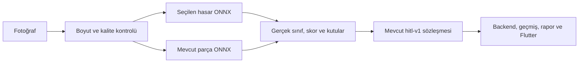

# HITL transfer learning ve güvenilirlik deneyleri

Çalışma `master` üzerindeki `9b38355` revizyonundan başladı. Bu belge, önceki
YOLOX-Tiny deneyinin yerine geçen bir başarı iddiası değildir. Ölçülen son
karşılaştırma `TRANSFER_RESULTS.json` ve `TRANSFER_RESULTS.md` içinde tutulur;
eğitim checkpoint'leri, kaynak veriler ve ONNX dosyaları Git dışında kalır.
Deploy ve üretim aktivasyonu yapılmaz.

`source_revision` deneylerin başladığı depo baseline'ını belirtir. Yeni eğitim
araçları çalışma sırasında henüz commit edilmemişti; bu alan onların `9b38355`
içinde bulunduğu veya bit düzeyinde aynı eğitim kodu arşivlendiği iddiası değildir.
Son kod incelemesi, gerçek paket/ayar/ağırlık kayıtları ve test kanıtları birlikte
değerlendirilmelidir.

## Veri ve başarısızlık incelemesi

`TRANSFER_DATA_AUDIT.json`, aynı 1.095/137/138 kanonik görüntü ayrımının hash'lerini,
sınıf desteğini ve 384/416/512/640 girişlerde kutu boyutlarını kaydeder. Hasar
etiketi olan görüntü sayısı train/val/test için 652/80/81'dir. Parça etiketi
olmaması, görüntüde parça yok anlamına gelmez. Hasar deneyi, yalnızca hasar
etiketi bulunan görüntülerle ayrı eğitilir; etiketsiz parça görüntüleri negatif
yapılmaz.

- `Cracked`: toplam 76 nesne; eğitimde 61, validation'da 7, testte 8. Buna
  karşılık `Scratch` 3.228 nesne içerir. Makro AP ve nadir sınıf başarısı çok az
  örneğe bağlıdır.
- Önceki modelin 416 letterbox girişinde 382 kutunun kısa kenarı 2 pikselin altına düşer. `Paint chip`
  kutularının yaklaşık %71'i, `Scratch` kutularının %55'i 8 pikselden incedir.
  Bunları daha fazla epoch ile öğrenmek, kaybolan görüntü bilgisini geri getirmez.
- Önceki denetimde iki dejenere poligon nedeniyle bir hasar görüntüsü tüm
  anotasyonlarıyla karantinaya alınmıştır. Ek inceleme bir `Tail-light` kutu
  çifti için yüksek bbox örtüşmesi bulur. Bu, semantik hata kanıtı olarak
  otomatik düzeltilmez; uzman inceleme adayıdır. Ham veriye müdahale edilmez.
- Doğrulanmış hasarsız araç/araç dışı negatif veri ve bağımsız araç/çekim
  oturumu kimlikleri yoktur. Başarı oranlarından gerçek hasarsız fotoğraf
  yanlış alarm oranı çıkarılamaz.
- Son kaynak incelemesi 1.370 kanonik görüntüde pHash/dHash benzerliği taradı
  (`TRANSFER_SPLIT_SIMILARITY.json`). Train 271 / val 413 görsel çifti aynı
  araç ve sahnenin çok benzer görünümleri olarak işaretlendi; bu bir semantik
  etiket düzeltmesi değildir. İki kayıt da yalnızca parça etiketlidir; RF-DETR
  hasar train/validation görünümüne alınmamıştır. Tarihsel ayrımlar korunur, yeni kör veri iddiası
  yapılmaz. Belirlenen sıkı eşiklerle testle ilişkili aday bulunmadı; bu,
  farklı açı/kırpma örneklerinin veya aynı araçların kesinlikle ayrıldığı
  anlamına gelmez. EXIF dönüşü gerektiren kanonik görüntü bulunmadı.
- Önceki eğitim sıfırdan, küçük ortak omurgalı ve iki görevliydi. Checkpoint
  seçimi iki görevin ortalamasına dayanıyordu; parça başarısı yüksekken hasar
  başarısı düşük kalabiliyordu. Ayrı hasar modeli ve doğrudan hasar validation
  metriği bu seçim çatışmasını kaldırır. Hangi değişikliğin ne kadar katkı
  yaptığını kanıtlayan tam bir faktöriyel ablation yapılmış sayılmaz.

Önceki test artık görülmüş tarihsel bir holdout'tur. Karşılaştırma için aynı
görüntüler ve aynı etiketler kullanılır; yeni modeller bu testle seçilmez.
Bu veri, yeni ve kör bir üretim kabul seti olarak sunulmaz.

Ortak precision/recall hesabı, IoU eşleştirmesini her sınıfın içinde yapar;
üst üste gelen farklı parça sınıfları birbirinin gerçek pozitifini tüketmez.
Baseline da aynı `ml.metrics` evaluator'ıyla yeniden hesaplanır. Eski rapordaki
özellikle parça P/R farkları bu metrik düzeltmesinden kaynaklanabilir; model
başarısı artmış gibi sayılmaz. COCO mAP ayrıca kendi standart eşleştirmesini
kullanır. mAP için 0.001 skor tabanı, P/R/FP için 0.25 skor ve 0.5 IoU
çalışma noktası kullanılır.

## Lisans ve ek veri

Veri, framework ve hazır ağırlık izinleri ayrı ayrı
[lisans incelemesinde](COMMERCIAL_LICENSE_REVIEW.md) yer alır. RF-DETR Nano ve
Seg Nano'nun yayıncı tarafından Apache-2.0 olarak sunulan COCO ağırlıkları
resmî URL ve MD5 allowlist'inden indirilir. İçeriğin SHA-256'sı deney kaydına
alınır. RF-DETR Plus ve Ultralytics paketleri kurulmaz. Kod lisansı, belirsiz
bir veri veya ağırlık için izin sayılmaz.

Yeni SYNDCAR v1 kaynağı CC BY 4.0'dır. 3,2 GB yayıncı arşivi SHA-256 ile
doğrulanmış, yalnızca görüntü/anotasyon dosyaları çıkarılmıştır; içindeki
Python kodu çalıştırılmamıştır. 245 görüntüdeki 673 ortak `Cracks`/`Scratches`
anotasyonu ayrı alan farkı kontrolüne ayrılır. `Broken_Glass` ve `Broken_Lights`
HITL sınıflarına zorla çevrilmez. `SYNDCAR_AUDIT.json` kaynak, atıf, kamera
dağılımı, hash ve eşleme kayıtlarını içerir. Görüntüler büyük ölçüde aynı küçük
araç ve sentetik hasar örneklerinin yakın görünümleridir; 245 bağımsız gerçek
hasar vakası sayılmaz. HITL ile birebir piksel kopyası bulunmamıştır.

## Eğitim ve seçim

`TRANSFER_PROTOCOL.json` test açılmadan önceki kararları, split hash'lerini ve
yayın koşullarını kaydeder. Nadir sınıflar için repeat-factor sampling
(`threshold=0.2`, en fazla 3 tekrar) 652 kaynak eğitim görüntüsünden 709
örneklik deterministik bir eğitim görünümü üretir. Validation tekrarlanmaz;
test dosyaları eğitim dizinine kopyalanmaz. Tekrarlar yeni veri sayılmaz.

RF-DETR adayları gerçek COCO transferi, AdamW, encoder için ayrı öğrenme
oranı, warmup/cosine, mixed precision, gradient checkpointing, accumulation,
EMA ve validation early stopping kullanır. Yatay çevirme ve sınırlı renk
değişimleri yalnızca train'e uygulanır. Segmentation adayı ayrıca framework'ün
bbox/mask uyumlu crop kolunu kullanarak küçük hasar örneklerini büyütür.
Maskeler ve bbox'lar birlikte dönüştürülür. Validation/test augmentation yoktur.

Gerçek tamamlanan eğitimler sırasıyla 28, 17 ve 28 epoch'tur; early stopping
nedeniyle 30 epoch bütçesinin tamamı kullanılmamıştır. Deney ayarları, kaynak
ağırlıkların ayrı MD5/SHA-256 kimlikleri, GPU bellek tüketimi ve başarısız ilk
denemeler [eğitim kayıtlarında](TRANSFER_TRAINING_RUNS.json) saklanır. Nano
koşuları Albumentations 1.4.24 ile, segmentation koşusu OpenCV 5 mask flip
uyumluluğu için MIT lisanslı 2.0.8 ile tamamlanmıştır. İki ortamın envanteri
ayrı korunur; sürüm farkları saklanmaz.

384 ve 512 adaylarında hem çözünürlük hem öğrenme oranı değişir; segmentation
adayında mimari ve crop da değişir. Bunlar pratik model/ayar adaylarıdır;
çözünürlüğün veya segmentation'ın tek başına nedensel etkisi diye sunulmaz.
Segmentation modeli için mask AP ayrıca raporlanır; bbox API'sine aktarımda
validation bbox metriğine göre seçilen mevcut checkpoint kullanılır.

RF-DETR Nano'nun iki detection ayarı ve Seg Nano gerçekten fine-tune edilmiştir.
RT-DETR R18'in çok ölçekli CNN yaklaşımı ayrıca gerçek fine-tuning deneyine
eklenmiştir; kaynak ağırlığı Apache-2.0 olarak ayrıca doğrulanmış ve yayıncı
revizyonu/LFS SHA-256 ile sabitlenmiştir. Bu ek aşama RF-DETR sonuçları
görüldükten sonra ilan edilmiştir (`TRANSFER_RTDETR_PROTOCOL.json`); tarihsel
test yeni bir kör kabul seti gibi sunulmaz. Checkpoint ve aday seçimi yine
yalnızca validation üzerinden yapılır. Karşılaştırma bütün ticari modeller
arasında küresel bir optimum iddiası taşımaz.

RT-DETR, 640 RGB/PIL bilinear ve 0..1 rescale kullanır; ImageNet normalization
yapmaz. Eğitimde framework'ün portable PIL processor'ı seçilir ve Torch
içermeyen uygulama ön işlemesiyle karşılaştırılır. Aynı balanced train
görünümü, train-only yatay çevirme/ColorJitter, AdamW, ayrı omurga LR,
warmup/cosine, EMA ve gerçek CUDA bf16 eğitimi kullanılır. Sadece 8 sınıf
başlıklarının yeniden başlatıldığı, pretrained omurga/encoder ağırlıklarının
yüklendiği denetlenir. Sıfırdan eğitilmiş model transfer diye gösterilmez.

Önemli ön işleme farkı: kullanılan RF-DETR sürümünün validation yolu PIL
anti-aliasing ile, `predict()` yolu tensor resize ve `antialias=False` ile
çalışır. Aynı 384 checkpoint'inde, API'nin 100 kutu sınırı altında validation
mAP50:95 sırasıyla 0.06310 ve 0.04940 ölçülmüştür. Bu nedenle yeni adaylarda
validation ile aynı RGB/PIL-bilinear/ImageNet normalizasyonu seçilir. İki yol
Torchvision referansına karşı test edilir. Manifest hangi yolun kullanıldığını
açıkça kaydeder; modelin çıktısına güven veya skor eklenmez.

## API ve CPU çalışma zamanı



Python API görüntü işlerken RF-DETR, Transformers, Torchvision veya PyTorch import etmez.
İki ONNX grafiği sırayla çalışır; ortak parça modelinin ağırlıkları korunur.
Parça confidence eşiği 0.25 ve mevcut NMS eşiği 0.45 aynen tutulur. İlk
aday export'undaki 0.50 NMS farkı uyumluluk incelemesinde fark edilerek yeni
bundle dizinlerinde düzeltilmiş; test parity ve bütün CPU ölçümleri tekrarlanmıştır.
Asistan/E5 için mevcut PyTorch bağımlılığı kaldırılmaz. Eğitim paketleri ayrı
ortamdadır ve Docker çalışma zamanı gereksinimlerine eklenmez.

Mevcut `hitl-v1` alanları, 29 sınıf kimliği, en fazla 100 tespit/görev ve
0.25 güven alt sınırı korunur. DETR confidence değeri gerçek sigmoid
sınıf skorudur; YOLOX parça skoru objectness × sınıf olasılığıdır. Bu değerler
kalibre edilmiş doğruluk olasılığı diye sunulmaz. Hasar yoksa `INCONCLUSIVE`,
şiddet `UNKNOWN`, değişim kararı `null` kalır; sonuç hasarsızlık garantisine
dönüştürülmez. Krediler, geçmiş raporlar, RAG ve asistan sözleşmeleri korunur.

Parça kanıtı olmayan hasarı otomatik eleme, 384 validation deneyinde recall ve
AP'yi düşürdüğü için aktive edilmemiştir (`TRANSFER_CONTEXT_ABLATION.json`).
NMS eşik denemeleri de validation tanı raporunda tutulur; anlamlı olmayan
kazançlar için yeni üretim filtresi eklenmez.

RT-DETR için ayrıca 0.3/0.5/0.7/native class-aware NMS taraması yapılmıştır.
Plan native RT-DETR test dosyası oluşmadan kaydedilmiştir
(`TRANSFER_RTDETR_NMS_PROTOCOL.json`). Precision'da en az 0.02 mutlak kazanç ve
recall'da en fazla 0.02 kayıp koşulunu sağlayan ayar yoktur. Kutulara yeni
filtre veya skorlara düzeltme eklenmemiştir; sonuçlar ayrı tanı raporundadır.

RT-DETR'in yüksek validation macro AP'si tarihsel testte Nano 512'yi geçeceği
anlamına gelmemiştir. Validation ön seçimi audit kaydında korunur; test
sonucuna bakılarak sessizce üretim adayı değiştirilmez. Bütün adaylar ortak
precision/recall/mAP koşullarını geçemediği için **üretim modeli seçilmemiştir**.

Model/katalog hash'leri, iki grafiğin giriş/çıkış imzaları ve sabit ön işleme
profili yüklemeden önce denetlenir. Bundle değişirse süreç yeniden başlatılmalıdır.
Tüm export'lar `production_approved: false` üretir. Python/Java/Flutter analiz
bayraklarının varsayılan kapalı durumu değiştirilmez.

## Tekrarlama

Komutlar `ai-service` dizininden çalışır. CUDA PyTorch ve ona uygun Torchvision
ayrı eğitim ortamına kurulmalıdır. Bu çalışmada GPU RTX 4050 Laptop 6 GB,
PyTorch 2.13.0+cu130 ve Torchvision 0.28.0+cu130 kullanılmıştır. Windows'ta
Triton assignment bulunmadığından resmî eğitim kodu SciPy matcher'a düşmüştür.

```powershell
python -m pip install -r requirements-transfer.txt
python -m ml.analyze_failures --output ../docs/ml/TRANSFER_DATA_AUDIT.json
python -m ml.prepare_transfer --output datasets/transfer-damage-balanced --repeat-threshold 0.2
python -m ml.transfer_train --output training-runs/rfdetr-nano-384 --epochs 30 --batch 8 --accumulate 1 --workers 0
python -m ml.transfer_train --output training-runs/rfdetr-nano-512 --size 512 --epochs 30 --batch 4 --accumulate 2 --workers 0 --lr .0003 --encoder-lr .00015
python -m ml.transfer_train --output training-runs/rfdetr-seg-384 --variant seg-nano --epochs 30 --batch 4 --accumulate 2 --workers 0
python -m ml.transfer_evaluate --checkpoint <selected.pth> --data datasets/hitl-coco/val.json --output evaluation-runs/val.json
python -m ml.transfer_evaluate --checkpoint <selected.pth> --data datasets/hitl-coco/test.json --output evaluation-runs/test.json
python -m ml.transfer_export --checkpoint <selected.pth> --output models/candidate --images <photo1> <photo2>
python -m ml.transfer_verify --bundle models/candidate --data datasets/hitl-coco/test.json --reference evaluation-runs/test.json --output evaluation-runs/parity.json
# Ayrı, Torch import etmeyen CPU süreci:
python -m ml.transfer_benchmark --bundle models/candidate --image <photo> --output evaluation-runs/cpu.json
python -m unittest discover -s tests -v
```

RT-DETR ek aşaması aynı ayrı eğitim ortamından çalışır:

```powershell
python -m ml.fetch_rtdetr
python -m ml.rtdetr_train --output training-runs/rtdetr-r18-640
python -m ml.finalize_rtdetr --run training-runs/rtdetr-r18-640 --wait
```

Kaynak ağırlık yalnızca publisher safetensors dosyasıdır; Python pickle veya
remote model kodu indirilmez/çalıştırılmaz. Mevcut parça checkpoint'i önceki
HITL baseline'ından gelir. Komutları yeniden çalıştırmak için yeni deney,
sonuç ve bundle dizinleri seçilmelidir; mevcut ölçümler üzerine yazılmaz.

Üç eğitim tamamlandığında ortak seçim/karşılaştırma için
`python -m ml.finalize_transfer --nano384 <run384> --nano512 <run512> --seg <runseg> --output <new-results> --models <new-bundles> --runtime-python <runtime-python>`
kullanılır. Mevcut çalışma dizinleri eğitim kayıtlarında belirtilir; araçlar
mevcut deneyleri silmez veya üzerine yazmaz. İlk sonuçların parça NMS
uyumluluk incelemesi `python -m ml.review_transfer` ile ayrı sonuç ve bundle
dizinlerine yazılmıştır. Eski sonuç dosyasının SHA-256'sı yeni raporda tutulur;
inceleme hasar modeli veya eşik seçimini test üzerinden değiştirmez.

Validation üzerinden eşik seçimi precision ≥ 0.70 koşuluyla F2'yi artırmayı
dener. Uygun nokta yoksa bunu `constraint_satisfied: false` olarak raporlar;
eksik başarının yerine skor üretilmez. Testte bütün adaylar için ayrıca aynı
0.25 çalışma noktası raporlanır. ONNX kontrolü yalnızca bir fotoğraftaki
karşılaştırmayı değil, aynı holdout üzerinde metrik eşleşmesini de gerektirir.
512 modelinin 12 MP kontrol fotoğrafında düşük güvenli bazı proposal satırları
PyTorch/ORT arasında farklılaşmıştır; bütün tensor satırları için `allclose`
sonucu başarısız olarak saklanır. Aynı fotoğraftaki API tespitleri ise sınıf ve
sayı bakımından eşleşmiş, eşlenen kutuların en düşük IoU'su 0.99994 olmuştur.
Bu sonuç ham tensor parity'si diye adlandırılmaz. Validation kümesinin tamamında
ayrıca gerçek ONNX/PyTorch mAP, precision ve recall farkı denetlenir.

INT8 MatMul deneyi, 384 adayının validation mAP50:95 değerini yaklaşık 0.00923
düşürdüğü için önceden belirlenen 0.005 kayıp sınırını geçememiştir. Daha küçük
dosya boyutu doğruluk kaybının yerine kabul edilmez; bu aday seçilmez.

Gerçek Railway CPU/RAM kotasında yük testi, yeni kör gerçek saha holdout'u,
temiz negatifler ve uzman hasar-parça ilişki kontrolü tamamlanmadan üretim
uygunluğu iddia edilmez. Yerel CPU sonuçları JVM, Gemini, ağ ve E5/RAG
belleğini kapsamaz. Docker veya canlı deployment doğrulaması yerine geçmez.
