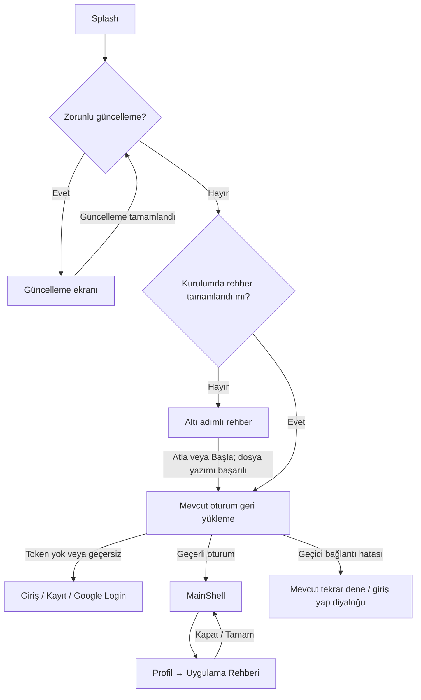

# İlk açılış rehberi

> Aşağıdaki Flutter uygulama ve test ayrıntıları 22 Ekim tarihli tarihsel kayıttır. Güncel rehber `mobile-rn/src/features/onboarding/` ve `mobile-rn/app/(app)/guide.tsx` içindedir. Kurulum işareti `modules/ekspersiz-native/` tarafından aynı dosya/içerikle korunur; font ve rehber görselleri RN asset dizininde bağımsızdır. Güncel çalıştırma/test: [RN README](../../mobile-rn/README.md).

Rehber `mobile/lib/features/onboarding` altında bağımsız bir Flutter özelliğidir.
Altı adım; karşılama, iki fotoğrafla AI analizi, rapor/geçmiş, araç ve bakım
takibi, AI Asistan/yakındaki servisler, kredi/kurumsal kullanım sırasını izler.
İçerik gerçek ekranlara dayanır; ücretsiz/sınırsız kullanım, kesin hasar tespiti,
sabit fiyat veya her hesapta kurumsal yetki vaat etmez. Servis keşfi analiz
sonucuna bağlıdır; araç kapasitesi ve ayrı kredi bakiyeleri mevcut sistemdedir.

## Açılış ve navigasyon



Splash kendi kök rotasında rehberi gösterir. Tamamlama dosyası yazılmadan
oturum geri yüklemeyi veya giriş ekranını başlatmaz. Böylece rehber sırasında
MainShell'in bildirim/konum izinleri ve API çağrıları tetiklenmez. Rehberin
kendisi ağ, kimlik doğrulama, satın alma veya izin servisi çağırmaz.

Profil aynı ekranı `OnboardingScreen.replay` ile ayrı bir rota olarak açar.
Bu mod kalıcılık deposuna dokunmaz, oturum geri yüklemez ve profil sekmesini
sıfırlamaz. Sistem geri eylemi ara adımlarda önceki sayfaya gider; ilk adımda
profil rotasına döner veya ilk açılışta uygulamadan çıkar. Kapat/Atla her
sayfadan kullanılabilir. Tamamlama yazımı sırasında yinelenen eylemler engellenir.

## Kuruluma özgü kalıcılık

`OnboardingStore`, sabit `onboarding_completed` dosyasına `completed` yazar.
İsim içerik sürümüne veya uygulama versiyonuna bağlı değildir. Önce aynı
dizinde geçici dosya diske yazılır, sonra yeniden adlandırılır; yarım yazım
tamamlanma sayılmaz. Dosya okuma hatası rehberi gösterir; yazma hatası yerinde
yeniden deneme sunar ve başarılı kaydetmiş gibi davranmaz.

Mevcut `path_provider` masaüstünde uygulama destek dizinini kullanır. Android
ve iOS'ta küçük `ekspersiz/installation` kanalı yalnızca uygun yerel dizini
döndürür; yeni paket veya platform izni yoktur:

- Android: `Context.noBackupFilesDir/installation`. Auto Backup ve cihazlar
  arası aktarım bu dizini taşımaz.
- iOS: `Application Support/installation`; dizin, içine dosya yazılmadan önce
  `isExcludedFromBackup` ile yedeklemeden hariç tutulur. Keychain kullanılmaz.
- Dosya güncellemeler boyunca kalır, uygulama verisi silindiğinde veya tam
  kaldırmada silinir. iOS “Uygulamayı Boşalt” verileri korur; tam silme değildir.

Bu depo `TokenStorage` ile tamamen ayrıdır. Logout, hesap silme, token yenileme,
`deleteAccessToken()` veya `clearAll()` rehberi sıfırlamaz. Yeni hesap için yeni
bir tamamlanma kaydı tutulmaz. Kullanıcı rehberi bitirmeden kapatırsa sonraki
açılış ilk adımdan başlar.

Bu özelliğin ilk kez geldiği mevcut kurulumlarda henüz işaret bulunmadığından
rehber bir kez gösterilir; varsa oturum sonrasında normal biçimde geri yüklenir.
Tamamlanmış rehber, sonraki uygulama veya içerik güncellemelerinde tekrar açılmaz.

Platform dayanakları: [Android Auto Backup](https://developer.android.com/identity/data/autobackup),
[Apple backup exclusion](https://developer.apple.com/documentation/foundation/urlresourcevalues/isexcludedfrombackup),
[Flutter platform channels / implicit engine](https://docs.flutter.dev/platform-integration/platform-channels).

## Görseller, tema ve erişilebilirlik

Görseller paket içi Flutter bileşenleri ve CustomPainter çizimleridir; indirilen
resim, harita, gerçek kullanıcı raporu veya canlı bakiye içermez. Küçük örnek
arayüzler dekoratiftir ve ekran okuyucudan çıkarılmıştır. Açıklamalar normal
ölçeklenebilir metin olarak ayrıca sunulur.

Mevcut `AppTheme`, `AppBackground`, `AppMotion`, `PrimaryButton` ve `AppText`
kullanılır. Yatay PageView, tablet/yatay ekranda yan yana düzen, gerektiğinde
dikey kaydırılan içerik, güvenli alanlar ve en az 48 dp eylemler desteklenir.
Başlık semantiği, canlı adım bildirimi ve azaltılmış hareket ayarları vardır.

Mevcut temanın Google Fonts üzerinden yüklediği Inter Regular/Medium artık
`assets/fonts` içinde paketlenir; mevcut asset dizini bunları otomatik kapsar.
Tema veya bağımlılık sürümü değiştirilmez. Dosyaların SHA-256 değerleri kullanılan
`google_fonts 8.2.1` tanımlarıyla eşleştirilmiştir; lisansı `Inter-OFL.txt` içindedir.

## Doğrulama

22 Ekim 2026, Windows / Flutter 3.44.8 doğrulaması: `flutter analyze --no-pub`
sorunsuz; tüm **214 test** geçti (rehbere özel 38 test dahil); Android debug APK
başarıyla derlendi. iOS derlemesi bu ortamda çalıştırılmadı.

`mobile` dizininden:

```sh
flutter analyze --no-pub
flutter test --no-pub
flutter build apk --debug --no-pub
flutter test --no-pub test/features/onboarding --dart-define=UPDATE_ONBOARDING_PREVIEWS=true
```

Son komut dark/light altı sayfanın PNG önizlemelerini
`mobile/build/onboarding-preview/` altına yazar. Önizlemeler gerçek paketli Inter
fontlarını kullanır; build çıktıları kaynak kontrolüne alınmaz.

Otomatik test kapsamı:

| Senaryo | Doğrulama |
| --- | --- |
| İlk kurulum, tekrar açılış | Gerçek geçici dosya deposu ve Splash widget testleri |
| Başla / Atla | Yazma tamamlanmadan geçiş yok; çift tıklama tek yazım |
| Yarıda kapatma | İşaret yazılmaz; yeniden açılış ilk adım |
| Logout, clearAll, hesap değiştirme | Gerçek TokenStorage/AuthService ile işaret korunur |
| Eksik/bozuk dosya, kesilen yazım, depolama hatası | Tekrar gösterim ve yeniden deneme |
| Güncelleme engeli ve güncelleme sonrası devam | Rehberden önce engel; kontrol yeniden çalışır |
| Session restore | Geçerli oturum → MainShell; 401 → login; timeout → mevcut hata akışı |
| Profil rehberi | Kapat, Tamam, sistem geri → aynı profil |
| Giriş yöntemleri | Login, Google giriş düğmesi ve kayıt rotası erişilebilir |
| Çevrimdışı | Gerçek font assetleriyle ağdan font alma kapalı; rehber ek servis çağırmaz |
| Ekranlar | İki temada altı adım: 320×568 (%100/%200/%300), 390×844, 844×390 (%150), 1024×768 (%200) |
| Erişilebilirlik | Adım semantiği, azaltılmış hareket, etiket, kontrast ve dokunma alanları |

Windows ortamında iOS derleme, VoiceOver/TalkBack cihaz deneyimi, Play'in gerçek
zorunlu güncelleme ekranı, Google OAuth ve işletim sistemi yedek geri yükleme
senaryoları çalıştırılamaz. Yayın öncesi Android/iOS cihazda yeni kurulum,
veriyi koruyan güncelleme, tam kaldırıp yeniden kurma ve uçak modu ile bu
platform davranışları ayrıca kontrol edilmelidir. Otomatik testler gerçek bir
mağaza güncellemesi veya canlı Google hesabıyla oturum açma iddiasında bulunmaz.
