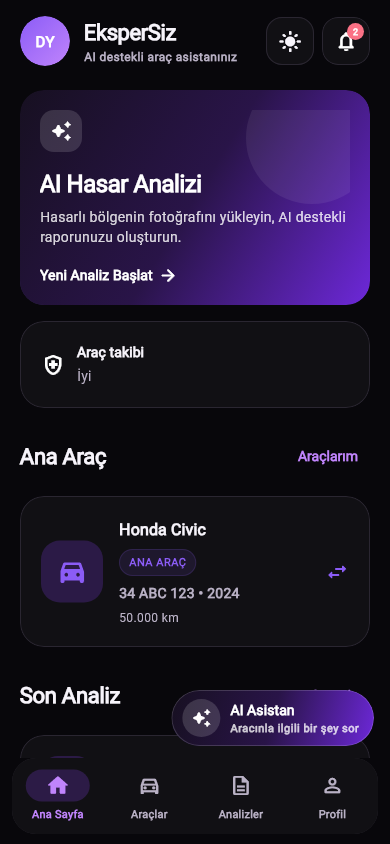
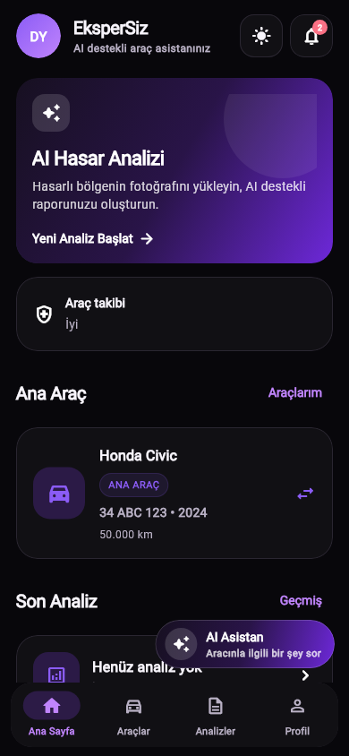
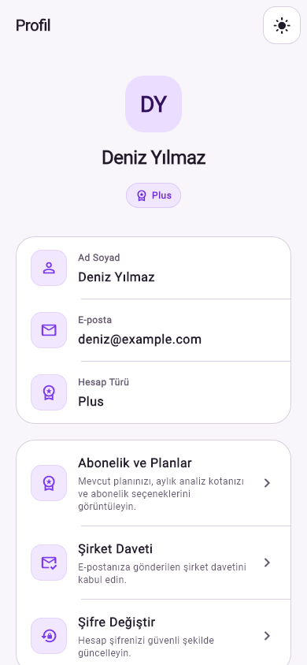
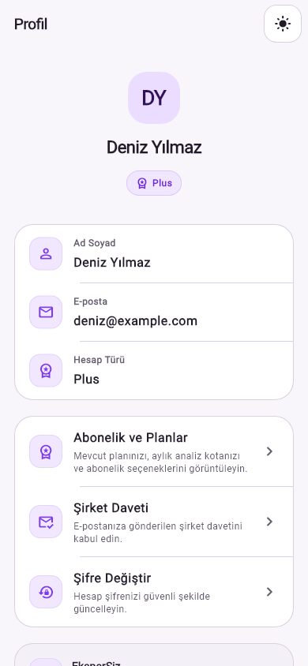

# Orantılı ve kompakt arayüz ölçüleri

17 Ekim 2026. Taban: `master` / `a5e1b04`. Dal: `feature/compact-proportional-ui`.
Mevcut sayfa düzeni ve görsel hiyerarşi korunarak ortak ölçüler ve büyük ekran
boşlukları azaltıldı. Renkler, Inter font ailesi, köşe yarıçapları, animasyonlar,
breakpoint'ler, SafeArea, klavye davranışı ve iş akışları aynı kaldı.

## Önce / sonra

Değerler Flutter mantıksal pikselidir; yazı ölçeği arttığında alanlar büyümeye devam eder.

| Ölçü | Önce | Sonra |
| --- | ---: | ---: |
| Sayfa yatay boşluğu | 20 | 18 |
| Ortak kart dolgusu / büyük sonuç kartı dolgusu | 20 / 22 | 18 / 20 |
| Orta / büyük / çok büyük aralık | 16 / 24 / 32 | 15 / 22 / 30 |
| AppBar yüksekliği / başlık boyutu | 64 / 20 | 60 / 19 |
| Alt navigasyon yüksekliği | 76 | 72 |
| Ana buton minimum yüksekliği | 54 | 50 |
| Çerçeveli buton minimum yüksekliği | 52 | 48 |
| Input iç dolgusu, yatay/dikey | 18 / 18 | 16 / 16 |
| Sayfa başlığı / bölümün büyük başlığı | 24 / 22 | 22 / 20 |
| Ortak dekoratif ikon kutusu / ikon | 46 / 23 | 42 / 22 |
| Giriş logosu / profil avatarı | 96 / 72 | 88 / 66 |
| Gövde metni büyük / orta / küçük | 16 / 14 / 12 | 16 / 14 / 12 |

Kontrol, ikon butonu ve metin butonu dokunma alanları en az 48 × 48 tutuldu.
Menü öğeleri, küçük rozet yazıları ve navigasyon etiketleri ayrıca küçültülmedi.
Uzun içeriklerde sabit yükseklik, yeni kırpma veya yazı ölçeği kısıtlaması eklenmedi.
Yüzen butonlar ve navigasyon için ayrılan alt boşluklar korunuyor.

390 × 844, DPR 1 ve yazı ölçeği 1'de aynı fixture'larla widget ölçümleri:

| Bileşen | Önce | Sonra | Fark |
| --- | ---: | ---: | ---: |
| Giriş ekranındaki ana buton | 54 | 50 | −%7,4 |
| Profil bilgi kartı (üç satır) | 238 | 223 | −%6,3 |
| Ana sayfa takip kartı | 87 | 83 | −%4,6 |
| Sonuç ekranı üst kartı | 266 | 258 | −%3,0 |

Her parçaya aynı ölçek uygulanmadı; metin ağırlıklı kartlarda okunabilirlik tercih
edildi. Bunlar cihaz performans ölçümleri değildir. Görsel karşılaştırmalar mevcut
offline test altyapısının **Roboto metrikleriyle** üretildi; üretimdeki Inter değişmedi.

| Ana sayfa, koyu tema: önce | Sonra |
| --- | --- |
|  |  |

| Profil, açık tema: önce | Sonra |
| --- | --- |
|  |  |

## Değişen dosyalar

`mobile/lib/core/theme/app_theme.dart` ortak spacing, padding, başlık ve kontrol
ölçülerinin kaynağıdır. `core/widgets/` altında `app_card`, `app_icon_box`,
`app_page_header`, `app_section_header`, `app_adaptive_columns`, `app_state_view`,
`auth_shell` ve `theme_toggle_button` bu oranlara uyarlandı.

`mobile/lib/features/*/screens/` altında:

- Auth: `login`, `register`, `forgot_password`, `email_verification`, `change_password`, `splash`.
- Ana sayfa / profil / AI: `home`, `profile`, `ai_assistant`.
- Analiz: `create_inspection`, `upload_damage_image`, `analyzing`, `inspection_result`, `inspection_history`, `damage_assessment_record`.
- Araç: `vehicle_list`, `vehicle_detail`, `add_vehicle`, `maintenance_form`, `reminder_form`.
- Diğer: `business_management`, `subscription`, `notification_center`.

Yukarıdaki ekran adlarının dosya uzantısı `_screen.dart`tır. Araç eklemedeki
ExpansionTile'a şeffaf Material yüzeyi eklendi; genişletilen testlerin yakaladığı
ListTile dokunma efektinin kart arkasında kalması uyarısını giderir.

Testler: `test/core/widgets/compact_layout_test.dart`,
`test/features/compact_secondary_screens_test.dart`,
`test/features/responsive_screens_test.dart`. Bu rapor ve dört karşılaştırma PNG'si
de inceleme çıktılarıdır. Backend, servisler, AI, veri modeli, bağımlılıklar ve Railway
ayarları değiştirilmedi.

## Doğrulama

- `flutter test --no-pub`: **126 geçti, 0 başarısız**; önceki analiz ve güvenli görüntü yeniden kullanım testleri dahil.
- `flutter analyze --no-pub`: **0 sorun**.
- `git diff --check`: temiz.
- Açık/koyu temada 320 × 640 (%200 yazı), 390 × 844 (%100), 430 × 932 (%150),
  844 × 390 yatay (%150), 1024 × 768 (%100) senaryoları tarandı.
- Ortak kontroller DPR 1/2/3 ile, Android dokunma alanı guideline'ı ve büyüyen uzun
  etiketler üzerinden doğrulandı. Gövde yazıları ve sistem textScaler değerleri kontrol edildi.
- Formlar, sonuç/rapor, geçmiş, araç ekleme, işletme üyeleri, bildirim listeleri,
  AI mesaj gönderme, klavye, fotoğraf seçim sheet'i, navigasyon ve tema testleri geçti.

Gerçek Android/iOS cihazında Inter font metrikleriyle manuel kontrol yapılmadı.
Native kamera, Google Maps ve PDF paylaşımı için uçtan uca test çalıştırılmadı;
bu entegrasyonların işleyişi ve PDF belgesinin kendi ölçüleri değiştirilmedi.
