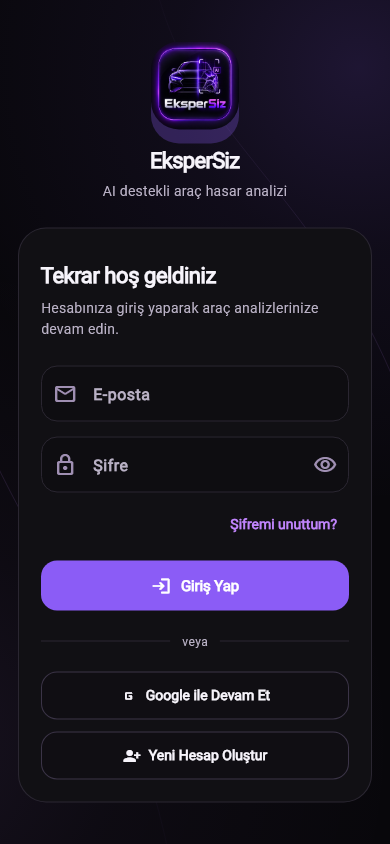
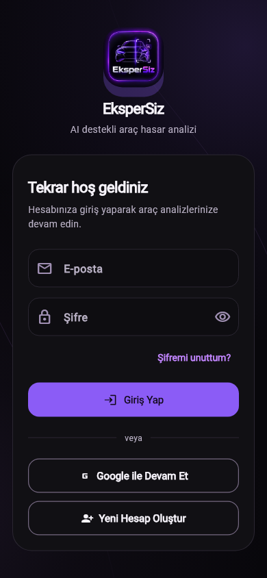
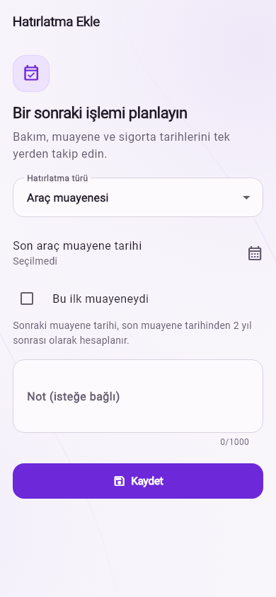
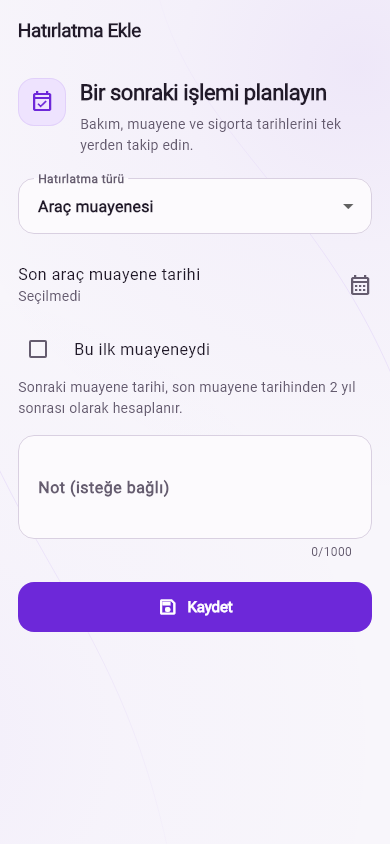

# Flutter arayüz tutarlılığı incelemesi

20 Ekim 2026 · Taban: `master` / `92b8c79` · Dal: `feat/flutter-ui-consistency`

Mor marka rengi, koyu öncelikli görünüm, sayfa arka planı, navigasyon, kart
köşeleri ve mevcut içerik sırası korundu. Yeni bağımlılık eklenmedi.
Servisler, modeller, API sözleşmeleri, kredi/abonelik hesaplamaları ve backend
değiştirilmedi.

## Bulgular ve uygulanan kararlar

| Alan | Bulgu | İyileştirme |
| --- | --- | --- |
| Primary / secondary | Global `FilledButton` renkleri tonal varyantını da primary yapıyordu. | Etkin renkler Material'ın ayrı `primary` ve `secondaryContainer` rollerine bırakıldı; iki tema ortak stil yardımcılarını kullanıyor. |
| Kontrast | Koyu temada mor primary üstünde beyaz etiket kontrastı 4,23:1 idi. | Mor korunarak koyu etiket kullanıldı: 4,63:1. Filled ikon ve yüzen buton da uygun ön plan rolünü kullanıyor. |
| Outlined | İnce dekoratif kart sınırı, aksiyon sınırı olarak da kullanılıyordu. | 1,2 px kontrol sınırı; koyu yüzeyde 3,64:1, açık yüzeyde 4,62:1 kontrast. Klavye odağında 2 px primary sınır; disabled durumda daha hafif sınır. |
| Buton ölçüleri | Filled / outlined minimum yükseklikleri farklıydı; tema genişliği sonsuza zorluyordu. | İkisi de minimum 50 px. En az 48 px dokunma alanı korunuyor. Tam genişliği ekran/bileşen belirliyor; diyaloglar içerik genişliğini kullanabiliyor. |
| Sayfa ve bölüm başlıkları | Mobil başlıklarda ikon ayrı satırda gereğinden fazla yer kaplıyordu. | 48 px ikon, dengeli yazı ağırlığı ve 14 px açıklama. Uygun genişlikte yatay, dar alanda veya büyütülmüş yazıda dikey düzen. |
| Durum ekranları | Loading / empty / error simgesi ve başlığı içerikle yarışıyordu. | Ortak `AppStateView` içinde 72 px ikon alanı, daha ölçülü başlık ve açıklama. Scroll, retry ve canlı bölge semantiği korundu. |
| Araç listesi | İkon ve menü, ad/rozet/kilometre için kalan alanı daraltıyordu. | 48 px ikon; araç adı satır kaydırıyor. Rozetler ve kilometre kartın tam genişliğini kullanıyor. |
| Araç detayları | Bölüm başlıkları ortak bileşeni tekrar ediyordu; ekleme ikonları etiketsizdi. | `AppSectionHeader` kullanılıyor; ekleme aksiyonlarında tooltip ve outlined görünüm var. |
| Form etkileşimleri | Bakım, hatırlatma ve tutanak işlemleri ayrı loading düğmeleri oluşturuyordu. | Mevcut `PrimaryButton` tekrar kullanılıyor; etiket, spinner, tekrar basmayı engelleme ve büyük yazı davranışı ortak. |
| Konum | Şehir metninde `height: 0.80` ve fazladan satır sonu vardı. | Normal 1,5 satır yüksekliği ve doğal metin akışı. |
| Yakındaki servisler | Hata metni/retry aynı satırda sıkışıyor; puan ve mesafe tek satıra zorlanıyordu. | Retry ayrı satırda, mesafe/puan wrap düzeninde. Error ve empty paneller mevcut kaydırılabilir harita panelini kullanıyor. |
| Auth | Splash içeriği kısa ekranda kaydırılamıyordu; şifre sıfırlama görünürlük ikonları etiketsizdi. | Splash kaydırılabilir; göster/gizle ikonları anlamlı tooltip taşıyor. |

## Ekran taraması

Kod incelemesi ortak tema, widget'lar ve aşağıdaki ekran gruplarını kapsadı.
Her ekrana ayrı bir görünüm eklemek yerine mevcut başarılı bileşenler korundu.

| Ekranlar | Sonuç |
| --- | --- |
| Login, register, forgot password, email verification, change password, splash | AuthShell ve alan düzenleri korundu; ortak buton düzeltmeleri, splash ve tooltip iyileştirmeleri uygulandı. |
| Home, MainShell | Dashboard hiyerarşisi, adaptive columns, navigasyon ve azaltılmış hareket davranışı korundu. Ortak tema üzerinden aksiyon rolleri düzeltildi. |
| Vehicle list/detail/add, maintenance form, reminder form | Liste bilgi hiyerarşisi, ortak bölüm başlıkları ve loading aksiyonları iyileştirildi. Araç ekleme formu ortak başlık/tema değişikliklerini alıyor. |
| Create inspection, upload photo, analyzing | Fotoğraf ve analiz akışları korundu; başlık, konum, hata ve aksiyon stilleri ortak yapı üzerinden iyileştirildi. |
| Inspection history/result, damage assessment record, nearby services | Sonuç kartlarının bilgi sırası korundu; tonal aksiyonlar ayrıştı, tutanak loading bileşeni ve harita panelleri düzenlendi. |
| Profile, subscription, business management, notifications, AI assistant | Mevcut içerik ve iş akışları korundu; ortak buton, ikon, bölüm başlığı ve durum stilleri üzerinden tutarlılık sağlandı. Satın alma koşulları değiştirilmedi. |

## Doğrulama

- `flutter analyze --no-pub`: **0 sorun**.
- `git diff --check`: temiz.
- `flutter test --no-pub --reporter expanded`: **154 test geçti**.
- `flutter test --no-pub --dart-define=CAPTURE_UI=true tool/ui_preview_test.dart --reporter expanded`: **16 önizleme testi geçti**.
- Yeni regresyon kontrolleri: primary/tonal ayrımı, metin kontrastı ≥ 4,5:1,
  outlined sınır kontrastı ≥ 3:1, disabled ayrımı, filled ikon kontrastı,
  320 px / %200 yazıda diyalog aksiyonu ve uzun araç bilgisi/işlem menüsü.
- Mevcut testler: açık/koyu temada 320 × 640 (%200), 390 × 844 (%100),
  430 × 932 (%150), 844 × 390 yatay (%150), 1024 × 768 (%100);
  klavye açıkken form ve sohbet, 48 px dokunma alanları, reduced motion,
  tekrar gönderim engeli, fotoğraf akışı ve kredi/abonelik regresyonları.

Önizlemeler mevcut offline test altyapısının **Roboto metrikleriyle** üretildi;
üretimdeki Inter değiştirilmedi. Gerçek Android/iOS cihazında kamera, harita,
mağaza veya PDF paylaşımı uçtan uca çalıştırılmadı. Harita paneli düzeltmeleri
kod incelemesi ve statik analiz kapsamındadır; widget testleri native haritayı
çalıştırmıyor.

## Görsel karşılaştırmalar

390 × 844, yazı ölçeği %100, aynı test verileri.

| Giriş / koyu tema — önce | Sonra |
| --- | --- |
|  |  |

| Hatırlatma / açık tema — önce | Sonra |
| --- | --- |
|  |  |

Tüm önizlemeler yukarıdaki komutla `mobile/build/ui-previews/` altında yeniden
üretilebilir; araç listesi bu komutun kapsamına eklendi.
